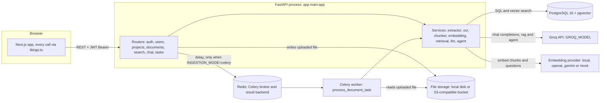
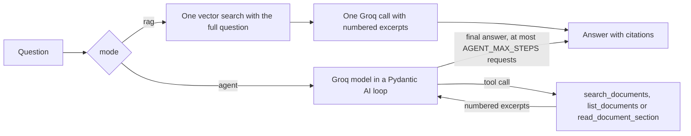

# DocMinds

DocMinds is a multi-tenant retrieval-augmented generation (RAG) platform for question answering over private documents. It ingests 19 file extensions (with OCR for scans), stores page-aware chunks as vectors in PostgreSQL with pgvector, and answers questions with citations to the exact file and page, either through a fast single-pass pipeline or a Pydantic AI agent that plans its own searches.

[](https://github.com/dhanoliya-ji/DOCMINDS/actions/workflows/ci.yml)
[](https://github.com/dhanoliya-ji/DOCMINDS/actions/workflows/codeql.yml)
[](https://codecov.io/gh/dhanoliya-ji/DOCMINDS)
[](https://scorecard.dev/viewer/?uri=github.com/dhanoliya-ji/DOCMINDS)
[](https://github.com/dhanoliya-ji/DOCMINDS/releases/latest)

**[Live demo](https://docminds-dhanoliya.vercel.app)** · [API docs](https://docminds-api.onrender.com/docs) · [Health](https://docminds-api.onrender.com/api/v1/health). The demo runs on free tiers, so the first request after an idle period can take up to a minute.

| Chat with citations | Semantic search | Document library |
|---|---|---|
|  |  |  |

## Key features

- **Broad ingestion:** PDF, DOCX, PPTX, XLSX/XLS, HTML, EML, TXT/Markdown, CSV, images and ZIP archives, with OCR fallback for scanned pages.
- **Semantic search:** page-aware chunking, configurable embeddings (local, OpenAI, Gemini) and HNSW-indexed cosine search in pgvector.
- **Grounded answers:** every answer cites numbered excerpts mapped to file and page; weak matches are discarded so the system can say it does not know.
- **Two chat modes:** a single-pass RAG pipeline, or a Pydantic AI agent with search, list and read tools.
- **Answers you can judge and pass on:** each answer carries a high / medium / low confidence badge computed from retrieval scores and citation coverage (with the reasons), renders Markdown tables and bar / line / pie charts drawn from figures in the documents, and streams token by token in both modes. Answers, conversations and projects can be shared through read-only public links (expiring, revocable, audited, stored only as an HMAC), and a prompt library offers built-in, personal and team-shared prompts.
- **Document comparison:** pick two documents and get a structured list of what was added, removed or changed, each difference citing the passages on both sides.
- **Multi-tenant by design:** organisation scoping is enforced inside every SQL query, including the vector search. Existing organisations can only be joined by invite.
- **Access control:** viewer, editor and admin roles; member management, invites, API keys, an audit log and a usage page for admins under `/settings`; rotating refresh tokens with silent refresh in the browser, server-side logout, password reset and email verification pages. The frontend hides actions a role cannot perform and sends a Content-Security-Policy and other security headers.
- **Background ingestion:** Celery workers via Redis, or inline processing for single-service deployments. Transient failures are retried with backoff, a database claim stops a job running twice, and a recovery sweep re-queues documents orphaned by a dead worker.
- **Hardened uploads:** size limits enforced while streaming, an extension allowlist plus content sniffing, sanitised filenames and server-generated storage keys, zip-bomb limits for archives and Office files, and optional ClamAV scanning.
- **Pluggable file storage:** local disk by default, or any S3-compatible bucket (AWS S3, Cloudflare R2, MinIO, Backblaze B2).
- **Limits and metering:** per-IP limits on sign-in, sign-up and password reset, per-user limits on chat, search and upload (Redis-backed, in-memory fallback), and per-organisation monthly token, document and storage quotas with usage and estimated cost reported to admins.
- **Robust model calls:** Groq is called asynchronously with retries, backoff and an optional fallback model; document text is fenced as untrusted data against prompt injection.
- **Observable:** structured JSON logs carrying a request id, user and organisation; optional Sentry; liveness and readiness health checks; security headers on every response.
- **Runs offline:** deterministic mock providers for OCR, embeddings and the LLM allow development and testing without API keys.

## Architecture



Uploads return `202 Accepted` immediately; extraction, OCR, chunking and embedding run in the worker (or inline), and the UI polls document status until it is ready. Detailed flow diagrams, the data model and module reference are in [docs/ARCHITECTURE.md](docs/ARCHITECTURE.md).

## Chat modes

Each question is answered in one of two modes, selected per message in the chat UI.



| | `rag` (Quick answer, default) | `agent` (Deep research) |
|---|---|---|
| Model calls | 1 | Several, capped by `AGENT_MAX_STEPS` |
| Searches | One, with the full question | As many as the model chooses |
| Latency and cost | Lowest | Several times higher |
| Best for | Direct questions | Multi-part questions, comparisons across documents, summaries |

Agent tools, all scoped to the caller's organisation and the session's project:

| Tool | Purpose |
|---|---|
| `search_documents(query, document_id?)` | Semantic search, optionally within one document |
| `list_documents()` | The project's documents with ids, types and status |
| `read_document_section(document_id, start_chunk, count)` | Up to 10 consecutive chunks of one document |

```bash
curl -X POST http://localhost:8000/api/v1/chat/sessions/$SESSION_ID/messages \
  -H "Authorization: Bearer $TOKEN" -H "Content-Type: application/json" \
  -d '{"message": "Compare annual leave for full-time and part-time staff", "mode": "agent"}'
```

The response contains the answer, `citations` (file, page, score, snippet), `model`, `mode` and, in agent mode, `steps` describing each tool call. Omitting `mode` selects `rag`.

## Tech stack

| Layer | Technologies |
|---|---|
| Backend | Python 3.11, FastAPI, SQLAlchemy 2 (async, asyncpg), Alembic, Pydantic |
| Data | PostgreSQL 16 with pgvector (HNSW), Redis 7 |
| Processing | Celery, PyMuPDF, python-docx, python-pptx, openpyxl, BeautifulSoup, tiktoken, Tesseract OCR (EasyOCR and PaddleOCR optional) |
| AI | Groq (`openai/gpt-oss-120b`), Pydantic AI, sentence-transformers, OpenAI or Gemini embeddings |
| Frontend | Next.js 16, React 19, TypeScript, Tailwind CSS |
| Testing and CI | pytest, Vitest, Testing Library, Playwright, Ruff, ESLint, GitHub Actions |

## Quick start

Requires Python 3.11+, Node.js 20.9+ and Docker. Install [Tesseract](docs/DEVELOPMENT.md#prerequisites) for OCR of scanned documents.

```bash
git clone https://github.com/dhanoliya-ji/DOCMINDS.git
cd DOCMINDS/backend
docker compose up -d                 # PostgreSQL + pgvector (port 5433) and Redis
cp .env.example .env                 # add GROQ_API_KEY (optional)
pip install -r requirements.txt
alembic upgrade head

uvicorn app.main:app --reload --port 8000                # terminal 1
celery -A app.core.celery_app worker --loglevel=info     # terminal 2 (add --pool=solo on Windows)

cd ../frontend                                           # terminal 3
npm install && cp .env.local.example .env.local && npm run dev
```

Open http://localhost:3000, create an account and a project, upload a document, and ask a question once it shows **Ready**. API documentation is served at http://localhost:8000/docs. Without a Groq key the app runs in demo mode, returning the best-matching passage instead of a generated answer.

## Configuration

Settings are read from environment variables or `backend/.env`. The most important ones:

| Variable | Default | Description |
|---|---|---|
| `GROQ_API_KEY` | *(empty)* | Groq API key; empty enables demo mode |
| `LLM_PROVIDER` | `groq` | `groq` or `mock` |
| `EMBEDDING_PROVIDER` | `local` | `local`, `openai`, `gemini` or `mock`; changing it requires re-processing documents |
| `AGENT_MODEL` | *(empty)* | Groq model for agent mode; empty reuses `GROQ_MODEL` |
| `AGENT_MAX_STEPS` | `6` | Maximum model requests per agent answer |
| `INGESTION_MODE` | `celery` | `celery` (worker) or `inline` (API processes uploads) |
| `DATABASE_URL` | *(empty)* | Postgres connection string; overrides `POSTGRES_*` |
| `REDIS_URL_OVERRIDE` | *(empty)* | Redis URL; overrides `REDIS_HOST` / `REDIS_PORT` |
| `SECRET_KEY` | development value | JWT signing key; must be replaced in any deployment (the app will not start with `ENV=production` and the default) |
| `SMTP_HOST` | *(empty)* | SMTP server for invite, reset and verification emails; empty writes them to the log |
| `STORAGE_BACKEND` | `local` | `local` (`backend/uploads`) or `s3` (any S3-compatible bucket; set `S3_BUCKET` and friends) |
| `MALWARE_SCAN` | `off` | `off` or `clamav` (scan every upload with a clamd daemon before processing) |
| `MAX_UPLOAD_SIZE_BYTES` | `104857600` | Per-file upload limit (100 MB), enforced while the file streams in |
| `RATE_LIMIT_LOGIN` / `RATE_LIMIT_CHAT` | `20/minute` / `30/minute` | Per-IP sign-in and per-user chat limits (others: signup, password reset, search, upload, `RATE_LIMIT_SHARE_VIEW` per IP for public links, `RATE_LIMIT_COMPARE` per user) |
| `TRUSTED_PROXY_COUNT` | `0` | Proxies in front of the API, so per-IP limits see the real client address (1 on Render) |
| `QUOTA_MONTHLY_TOKENS` | `1000000` | AI tokens per organisation per month; `0` is unlimited (also `QUOTA_MAX_DOCUMENTS`, `QUOTA_MAX_STORAGE_BYTES`) |
| `LLM_FALLBACK_MODEL` | *(empty)* | Groq model used when the main one keeps failing or is retired |
| `LOG_FORMAT` | `json` | `json` or `text` |
| `SENTRY_DSN` | *(empty)* | Optional error reporting; empty is off |

The complete reference, including OCR, retrieval and chunking settings, is in [docs/DEVELOPMENT.md](docs/DEVELOPMENT.md#configuration-reference).

## Testing

```bash
(cd backend && python -m pytest)     # unit tests; database tests run when Postgres is available
(cd frontend && npm run test:run)    # Vitest unit and component tests
(cd frontend && npm run test:e2e)    # Playwright end-to-end, against a running backend
```

See [docs/DEVELOPMENT.md](docs/DEVELOPMENT.md#testing) for test tiers and end-to-end prerequisites.

## Documentation

| Document | Contents |
|---|---|
| [docs/ARCHITECTURE.md](docs/ARCHITECTURE.md) | System design, pipeline and agent diagrams, data model, authentication, API surface, design decisions |
| [docs/DEVELOPMENT.md](docs/DEVELOPMENT.md) | Local setup, full configuration reference, testing, linting, troubleshooting, glossary |
| [docs/DEPLOYMENT.md](docs/DEPLOYMENT.md) | Hosted demo on Neon, Render and Vercel; Docker image; workers and failure handling; file storage (S3, R2, MinIO); malware scanning; backups; production checklist |
| [SECURITY.md](SECURITY.md) | Vulnerability reporting policy |

## Project structure

```
DOCMINDS/
├── backend/            FastAPI app, Celery tasks, Alembic migrations, tests, Dockerfile, docker-compose.yml
│   └── app/            core/, db/, models/, schemas/, api/, services/, tasks/
├── frontend/           Next.js app: app/ (routes), components/, lib/api.ts, tests/, tests-e2e/
├── docs/               Architecture, development and deployment guides; screenshots
├── .github/            CI, security scanning and repository automation workflows
└── render.yaml         Render blueprint for the API
```

## Security

Please report vulnerabilities privately as described in [SECURITY.md](SECURITY.md).
