# Architecture

Technical reference for DocMinds: how the components fit together, how a document becomes searchable, how a question is answered in each chat mode, and why the main design choices were made. For setup and configuration see [DEVELOPMENT.md](DEVELOPMENT.md); for hosting see [DEPLOYMENT.md](DEPLOYMENT.md).

## Contents

1. [System overview](#system-overview)
2. [Module reference](#module-reference)
3. [Ingestion pipeline](#ingestion-pipeline)
4. [Answering questions](#answering-questions)
5. [Streaming answers](#streaming-answers)
6. [Agent mode](#agent-mode)
7. [Data model](#data-model)
8. [Authentication and tenant isolation](#authentication-and-tenant-isolation)
9. [Limits, quotas and observability](#limits-quotas-and-observability)
10. [API surface](#api-surface)
11. [Frontend](#frontend)
12. [Answer quality](#answer-quality)
13. [CI pipeline](#ci-pipeline)
14. [Deployment topology](#deployment-topology)
15. [Design decisions](#design-decisions)

---

## System overview

The browser only talks to FastAPI. FastAPI either processes an upload itself (`INGESTION_MODE=inline`) or hands it to a Celery worker through Redis (`INGESTION_MODE=celery`, the local default). Both processes run the same services against the same Postgres database.

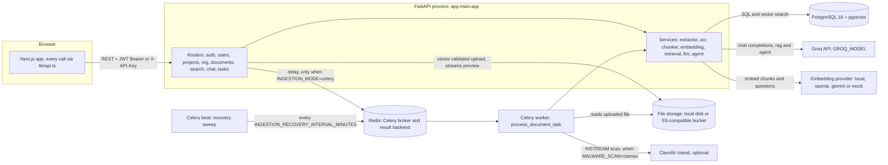

Only the document id crosses the queue, never the file. The API and worker read and write files through `services/storage.py`: with `STORAGE_BACKEND=local` they must share a filesystem (`LOCAL_STORAGE_DIR`), with `STORAGE_BACKEND=s3` they need only the same bucket settings. Beat and ClamAV are optional: without beat the recovery sweep still runs when the API starts, and with `MALWARE_SCAN=off` (the default) nothing is scanned.

---

## Module reference

Services contain all domain logic and never import FastAPI, so the same function runs from an endpoint, a Celery task or a script. Endpoints stay thin: authorise, validate, call a service, shape the response.

### Backend (`backend/app/`)

| Layer | File | Responsibility |
|---|---|---|
| Entry point | `main.py` | Configures JSON logging and (optionally) Sentry, builds the FastAPI app with its middleware stack (CORS, request context, security headers, upload size), maps `QuotaExceeded` to `402`/`429`, mounts routers, `GET /`, `GET /api/v1/health` (liveness) and `GET /api/v1/health/ready` (readiness); its lifespan starts the recovery sweep in the background |
| `core/` | `config.py` | Every setting, read once from the environment / `backend/.env` via pydantic-settings and validated at startup (including: `STORAGE_BACKEND=s3` requires `S3_BUCKET`) |
| | `upload_limit.py` | `UploadSizeLimitMiddleware`: a pure ASGI middleware that answers `413` for an upload request over `MAX_UPLOAD_SIZE_BYTES` x `MAX_FILES_PER_UPLOAD` + 1 MB, from `Content-Length` before the body is read, or by counting the body as it streams in |
| | `security.py` | bcrypt password hashing (passlib); JWT creation with `type`, `jti` and fractional `iat` claims; opaque token and API key generation and SHA-256 hashing; the password policy |
| | `roles.py` | The role ranking `Admin` (admin) > `Manager` (editor) > `Employee` (viewer), and the generic aliases |
| | `rate_limit.py` | Sliding-window rate limiter: Redis counters when reachable, in-memory otherwise (and while Redis is down); `check(name, identity)` returns a `Decision` with `retry_after` |
| | `client_ip.py` | The one answer to "which IP is this request from": `CLIENT_IP_HEADER`, then the Nth-from-right `X-Forwarded-For` entry for `TRUSTED_PROXY_COUNT`, then the TCP peer. Shared by the rate limiter, the audit log and the access log |
| | `middleware.py` | Pure ASGI middleware: `RequestContextMiddleware` (request id in/out via `X-Request-ID`, one access-log line per request with the route template, status and latency) and `SecurityHeadersMiddleware` (`nosniff`, `X-Frame-Options: DENY`, `Referrer-Policy`, `Permissions-Policy`, HSTS in production) |
| | `observability.py` | `configure_logging` (JSON or text formatter for every logger, uvicorn's included), the per-request/per-task logging context (`new_context`, `bind`), and `init_sentry` (lazy, off without `SENTRY_DSN`, never raises) |
| | `health.py` | The readiness checks: database `SELECT 1`, Redis `PING`, Celery worker ping; concurrent, each with `READINESS_TIMEOUT_SECONDS` |
| | `celery_app.py` | The Celery app; Redis as broker and result backend, `task_track_started`, results expire after 24 h, prefetch of one message, a Redis visibility timeout longer than any live job, and the beat schedule for the recovery sweep |
| `db/` | `session.py` | Async engine (asyncpg, `NullPool`) and `SessionLocal` (`expire_on_commit=False`, `autoflush=False`) |
| | `base_class.py` | Declarative `Base`; derives plural snake_case table names from class names |
| | `migrations/` | Alembic revisions: initial schema; then `a1b2c3d4e5f6`: `vector` extension, embedding column fixed at `vector(384)` (existing embeddings deleted), HNSW index, per-project dedup constraint; then `c3d5e7f9a2b4`: invites, refresh tokens, access-token denylist, emailed tokens, API key roles, `users.password_changed_at`, audit index; then `d4e6f8a0b2c5`: `documents.storage_backend`, `attempts`, `processing_started_at`, `error_message` and an index on `status`; then `e5f7a9b1c3d6`: the `usage_events` table and the per-organisation quota overrides `organizations.monthly_token_quota`, `max_documents`, `max_storage_bytes`; then `a7b9c1d3e5f8`: `chat_messages.mode`, `model` and `steps` (JSONB), and the GIN full-text index `ix_chunks_content_fts` on `to_tsvector('english', chunks.content)` for hybrid search |
| `models/` | `organization.py`, `user.py`, `project.py`, `document.py`, `chunk.py`, `chat.py`, `api_key.py`, `audit.py`, `invite.py`, `refresh_token.py`, `revoked_token.py`, `user_token.py`, `usage.py` | 16 SQLAlchemy tables, UUID primary keys, cascading foreign keys |
| `schemas/` | `user.py`, `token.py`, `organization.py`, `project.py`, `document.py`, `account.py`, `usage.py` | Pydantic request/response shapes (`Base` / `Create` / `Update` / `Out`); `*Out` use `from_attributes=True`. `account.py` covers reset, verification, members, invites, API keys and the audit log |
| | `rag.py` | Search and chat contract: `SearchRequest` and `ChatRequest` (`mode`, `document_ids`), `Citation`, `AgentStep`, `ChatMessageOut` (with `mode`, `model`, `steps`), `ChatResponse` (with `search_query`), `ChatSessionUpdate`, `FeedbackCreate`, `FeedbackSummary` |
| `api/` | `deps.py` | `get_db`, `get_current_user` (Bearer JWT or `X-API-Key`), `get_current_active_user`, `require_role` / `require_viewer` / `require_editor` / `require_admin`, `RoleChecker`, `rate_limit_by_ip` / `rate_limit_by_user` (route dependencies that answer `429` + `Retry-After`) |
| | `v1/auth.py`, `users.py`, `projects.py`, `documents.py`, `search.py`, `chat.py`, `tasks.py`, `org.py` | One router per resource, mounted under `/api/v1`. `org.py` is the admin-only members, invites, API keys, audit log, usage and feedback router. `chat.py` holds one answer pipeline (`_answer_events`, an async generator of events) that both the JSON and the SSE endpoint run |
| `services/` | `extractor.py` | `DocumentExtractor`: 19 file extensions to text with page markers; zip-bomb limits for archives and Office files (`UnsafeArchiveError`) |
| | `uploads.py` | Upload validation: `sanitize_filename`, the extension allowlist (exactly `extractor.SUPPORTED_EXTENSIONS`), `spool_upload` (1 MB chunks to a temp file, counted and SHA-256 hashed in one pass), `check_content` (magic bytes) |
| | `storage.py` | `get_storage`: `LocalStorage` or `S3Storage` (boto3, imported lazily) behind one interface (`save`, `exists`, `delete`, `iter_bytes`, `local_copy`); `new_key` makes server-side keys; botocore errors mapped to `StorageObjectNotFound` (permanent) or `StorageUnavailableError` (retry) |
| | `malware.py` | `scan_file`: nothing when `MALWARE_SCAN=off`, otherwise clamd's `INSTREAM` protocol over TCP or a Unix socket, no client library; `ScannerUnavailableError` when there is no verdict |
| | `ocr.py` | `OCRService`: Tesseract, EasyOCR, PaddleOCR or mock |
| | `chunker.py` | `ChunkerService`: page-aware chunking, token counts via `tiktoken` |
| | `embedding.py` | `EmbeddingService`: local, OpenAI, Gemini or mock vectors, batched |
| | `retrieval.py` | `RetrievalService`: tenant-scoped HYBRID search -- pgvector nearest neighbours plus Postgres full-text (`websearch_to_tsquery`, GIN-indexed), fused with reciprocal rank fusion (`reciprocal_rank_fusion`), optionally reranked; restricted to vectors from the current embedding model and optionally to a list of documents; chat history |
| | `query_rewrite.py` | `rewrite_query`: turns a follow-up ("and part-timers?") into a standalone search query from the history -- one small model call with a key, a heuristic without; only the search uses it |
| | `reranker.py` | Optional cross-encoder rerank of the fused candidates (`RERANKER=cross-encoder`); loads lazily and fails safe to the original order |
| | `export.py` | A conversation as Markdown, for `GET /chat/sessions/{id}/export` |
| | `feedback.py` | `summarise`: thumbs up / down for an organisation, by mode and model, with the recent thumbs-down questions |
| | `llm.py` | `LLMService`: numbered, fenced-excerpt prompt (untrusted-content rule); async Groq client with retries, backoff and `LLM_FALLBACK_MODEL`; `generate_answer` and the token-by-token `stream_answer` (which reports model and usage through a `stats` dict); demo fallback |
| | `agent.py` | `run_agent`: Pydantic AI agent, its three tools (output fenced like rag excerpts) and the citation registry; reports tokens in and out; `document_ids` limits every tool, `on_step` reports each tool call as it happens (used for streaming) |
| | `usage.py` | Metering and quotas: `record_chat_usage`, `check_token_quota` (`429`), `upload_allowance` (`402`), `usage_summary`, `estimate_cost_usd` from `LLM_PRICING` |
| | `sessions.py` | Refresh-token issue, rotation and revocation; the access-token denylist; single-use emailed tokens |
| | `audit.py` | `record`: stage an audit row in the caller's transaction |
| | `email.py` | Invite, reset and verification emails; console sender by default, SMTP when `SMTP_HOST` is set; never raises |
| `tasks/` | `ingestion.py` | `process_document_task` / `async_process_document`: the ingestion pipeline; `claim_document`, `is_transient`, `run_inline_ingestion` (the same retry policy without Celery), `recover_stuck_documents` and its beat task `recover_stuck_documents_task` |
| | `test.py` | `add_numbers_task`, `dummy_process_document_task`: queue diagnostics |
| `eval/` | `harness.py`, `__main__.py`, `golden_example.json` | The evaluation harness: golden-set loader, retrieval hit rate and MRR, keyword check, LLM-judge faithfulness; `python -m app.eval` (see [Answer quality](#answer-quality)) |

Conventions worth knowing when changing the backend:

- **Every query is scoped to an organisation.** `RetrievalService.search` takes `org_id` as a required argument and filters on it inside the SQL.
- **Every external dependency has a `mock` provider** (`OCR_PROVIDER`, `EMBEDDING_PROVIDER`, `LLM_PROVIDER`), producing deterministic output with no keys or downloads.
- **Heavy imports are lazy.** `sentence_transformers`, `pydantic_ai` and `boto3` are imported inside the functions that need them, so a Gemini-embedding deployment never loads PyTorch, the app starts even without `pydantic-ai` installed, and local storage never loads boto3.
- **Nothing blocking runs on the event loop.** Groq is called through its async client; embedding the query, file storage, extraction and SMTP run in `asyncio.to_thread`.
- **Log, don't print.** Every module logs through `logging.getLogger(__name__)`; `extra={...}` fields become JSON fields, and the request or task context is added automatically.
- **Optional integrations are off by default.** S3 storage, ClamAV scanning, SMTP and Sentry are switched on by settings alone, and the app and every test run without credentials for any of them.
- **Files are reached only through `services/storage.py`.** No endpoint or task calls `open()` on an upload or touches boto3; each `Document` records the backend that holds its file.
- **Models must be imported in `models/__init__.py`**, and `db/migrations/env.py` imports `app.models`; otherwise autogenerate sees an empty metadata and drops tables. Always read a generated migration before applying it.
- **Celery tasks are named explicitly** (`name="app.tasks.ingestion.process_document_task"`) so the API and worker agree regardless of import path.

### Frontend (`frontend/`)

| Path | Responsibility |
|---|---|
| `app/page.tsx` | `/` landing page |
| `app/login/page.tsx` | `/login`: sign in and sign up (sign up with `org_name` creates an organisation and makes the user its Admin). `/login?invite=<token>` previews the invite and joins the inviting organisation instead |
| `app/forgot-password/page.tsx` | `/forgot-password`: request a reset link (one answer for every address) |
| `app/reset-password/page.tsx` | `/reset-password?token=`: choose a new password with the emailed token |
| `app/verify-email/page.tsx` | `/verify-email?token=`: confirms the address on load, sending the single-use token once |
| `app/dashboard/page.tsx` | `/dashboard`: list and create projects (editor and above); email-confirmation banner with "Resend link"; provider status from `/api/v1/health` |
| `app/project/[id]/page.tsx` | `/project/:id`: Documents, Search and Chat tabs; polls document status; editors and above get the upload zone, project rename / delete, and per-document rename, re-index and delete (`DocumentActions`) |
| `app/settings/page.tsx` | `/settings`: your account; for admins, Members (invite, change role, remove), API keys (shown once on creation), Audit log (paginated, filterable), Usage (token, document and storage quotas) and Feedback (answer ratings) |
| `app/layout.tsx`, `app/globals.css` | Shared shell, fonts, metadata, Tailwind theme |
| `components/UploadZone.tsx` | Drag-and-drop bulk upload: one request per file, three at a time, a progress bar and an error per file |
| `components/SearchPanel.tsx` | Hybrid search results with similarity scores and which half found them, the document filter, "View" into the source; no LLM |
| `components/ChatPanel.tsx` | Streaming chat: history sidebar (`ChatSidebar`), Quick answer / Deep research toggle, live tokens and research steps, Stop, document filter (`DocumentFilter`), citations with "View", copy and Markdown export, feedback |
| `components/SourceViewer.tsx` | The citation viewer: a PDF page drawn by pdf.js with the passage highlighted, or the extracted text around the cited chunk with the passage marked |
| `components/AuthCard.tsx`, `components/VerifyBanner.tsx`, `components/settings/*` | Shared signed-out frame and notices; the confirmation banner; the five settings panels and `QuotaBar` |
| `lib/api.ts` | Typed API client: token storage, `apiFetch`, silent refresh, `ApiError` (status + `Retry-After`), response interfaces, one method per endpoint; `streamQuestion` (SSE over `fetch`) with `parseSseBuffer`, and `uploadFile` (XHR, for upload progress) |
| `lib/pdf.ts`, `lib/highlight.ts`, `lib/export.ts` | pdf.js loaded on demand (main-thread worker, `isEvalSupported: false`, both for the CSP) with highlight boxes; whitespace-tolerant passage matching; Markdown copy / export |
| `lib/roles.ts`, `lib/password.ts`, `lib/useCurrentUser.ts` | Role checks for hiding actions, the password policy mirrored from the backend, and the `/users/me` hook |
| `security-headers.mjs` | The CSP and other security headers `next.config.mjs` sends on every route |

---

## Ingestion pipeline

### Upload and processing

`POST /api/v1/documents/upload` validates and stores the files and replies `202 Accepted` immediately. The slow work runs afterwards in `async_process_document` (`tasks/ingestion.py`), either in the Celery worker or as a FastAPI background task.

```mermaid
flowchart TD
    UP["POST /api/v1/documents/upload"] --> MW{"Whole request over the ceiling? (middleware, before parsing)"}
    MW -->|"yes"| MWX["413"]
    MW -->|"no"| ROLE{"Signed in as an editor or admin?"}
    ROLE -->|"no"| ROLEX["401 or 403"]
    ROLE -->|"yes"| OPT{"Chunk options in range?"}
    OPT -->|"no"| OPTX["422"]
    OPT -->|"yes"| TEN{"Project exists and belongs to the caller's org?"}
    TEN -->|"no"| TENX["404 or 403"]
    TEN -->|"yes"| SPOOL["Every file: sanitize the name, check the extension, spool in 1 MB chunks while counting and hashing, sniff the content"]
    SPOOL -->|"any file fails"| SPOOLX["400, 413 or 415 for the whole request, nothing stored"]
    SPOOL -->|"all pass"| DUP{"Same SHA-256 already in this project, or earlier in this request?"}
    DUP -->|"yes"| DUPX["Skip the file. 400 if every file was a duplicate"]
    DUP -->|"no"| VER["version = highest version of this filename + 1"]
    VER --> SAVE["storage.save under a new key: project_id/uuid.ext"]
    SAVE -->|"storage unreachable"| SAVEX["503, and objects already stored are deleted"]
    SAVE --> ROW["Insert Document: status pending, storage_backend, chunk settings in meta_data. Audit document.upload"]
    ROW --> COMMIT["Commit"]
    COMMIT --> MODE{"INGESTION_MODE"}
    MODE -->|"celery"| CEL["process_document_task.delay via Redis (a failure here leaves it pending for the sweep)"]
    MODE -->|"inline"| BG["BackgroundTasks run_inline_ingestion, after the 202 reply"]
    CEL --> RUN["async_process_document"]
    BG --> RUN
    RUN --> CLAIM{"Claim: one conditional UPDATE to processing, attempts + 1"}
    CLAIM -->|"no row matched"| SKIP["Skip: already claimed, completed or deleted"]
    CLAIM -->|"claimed"| FETCH["storage.local_copy: the path itself, or an S3 download to a temp file"]
    FETCH --> SCAN{"malware.scan_file"}
    SCAN -->|"infected"| QUAR["failed, quarantined, file deleted from storage"]
    SCAN -->|"clean or MALWARE_SCAN=off"| EXT["DocumentExtractor.extract: archive limits, per-format parser, OCR fallback, detect_language"]
    EXT --> TXT{"Any text extracted?"}
    TXT -->|"no"| FAIL["Failure handler: rollback, classify"]
    TXT -->|"yes"| CHK["ChunkerService.chunk_document: fixed_size, sentence or markdown"]
    CHK --> CLR["Delete this document's old chunks"]
    CLR --> INS["Insert Chunk rows"]
    INS --> EMBED["EmbeddingService.get_embeddings, one batched call"]
    EMBED --> CNT{"One vector per chunk?"}
    CNT -->|"no"| FAIL
    CNT -->|"yes"| VEC["Insert ChunkEmbedding rows with model_name"]
    VEC --> DONE["Merge stats into meta_data, status = completed, single commit"]
    FETCH -. "raises" .-> FAIL
    SCAN -. "scanner unavailable" .-> FAIL
    EXT -. "raises" .-> FAIL
    CHK -. "raises" .-> FAIL
    EMBED -. "raises" .-> FAIL
    FAIL --> KIND{"Transient, with retries left?"}
    KIND -->|"yes"| RETRY["status = pending, error_message set, retried with exponential backoff"]
    KIND -->|"no"| FAILED["status = failed, error_message and meta_data.error set"]
```

Deleting a document's existing chunks before inserting new ones makes re-processing idempotent, and the claim makes a duplicate delivery of the same job skip rather than run twice.

### Upload validation

Every file in the request is validated before any of them is stored (`services/uploads.py`), so one bad file refuses the whole request and leaves nothing behind.

| Check | How | Refusal |
|---|---|---|
| Request size | `UploadSizeLimitMiddleware`: `Content-Length` against `MAX_UPLOAD_SIZE_BYTES` x `MAX_FILES_PER_UPLOAD` + 1 MB, and the streamed body counted as the parser reads it (a chunked request has no `Content-Length`) | `413` before the multipart body is spooled |
| File count | At most `MAX_FILES_PER_UPLOAD` | `400` |
| Chunk options | `chunk_strategy` is `fixed_size`, `sentence` or `markdown`; `chunk_size` 50-4000; `chunk_overlap` 0-1000 and smaller than `chunk_size` | `422` |
| Filename | `sanitize_filename`: last path component only, NFC-normalised, control and bidi-override characters removed, Windows-reserved characters replaced, leading dots stripped, at most 200 characters with the extension kept. The result is only displayed and stored on the row | `400` if nothing usable remains |
| Extension | Must be in `extractor.SUPPORTED_EXTENSIONS`, so the allowlist and the parsers cannot drift apart | `415` |
| Size | Read in 1 MB chunks to a temporary file, counted against `MAX_UPLOAD_SIZE_BYTES` and SHA-256 hashed in the same pass; never read into memory whole | `413` as soon as the count crosses the limit; `400` if empty |
| Content | `check_content` compares the bytes with the extension: a `%PDF-` header in the first 1 KB; the image and `.xls` signatures; for `.zip` and Office files a readable zip, and for Office files a `[Content_Types].xml` plus the folder of that format (`word/`, `ppt/`, `xl/`), so a renamed `.xlsx` is not accepted as `.docx`; for text formats no binary signature and no NUL byte in the first 8 KB | `415` |

The stored object's key is always `<project_id>/<uuid4>.<extension>` (`storage.new_key`). The client's filename never appears in a path, so it cannot traverse directories, collide with another upload or hit a reserved device name. Content sniffing is a consistency check, not malware detection; that is the optional ClamAV scan.

### Document status

The four values of `Document.status`. The frontend labels them Queued, Processing, Ready and Failed; search only reads `completed` documents.

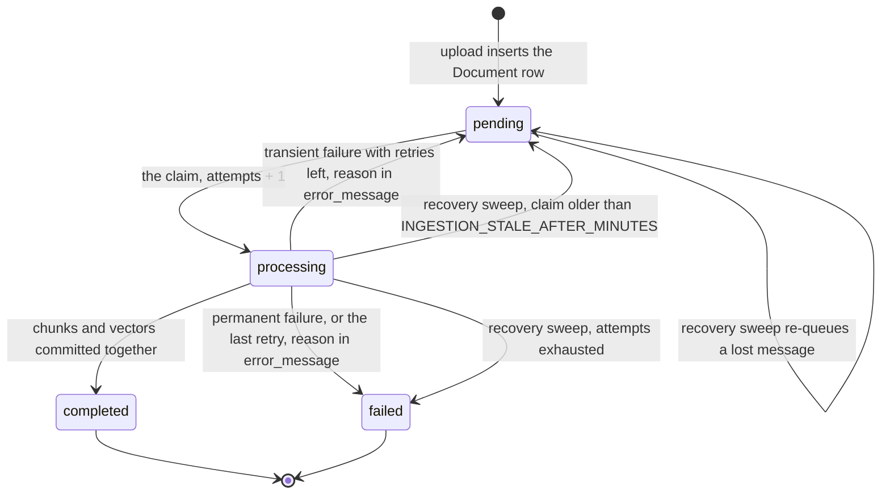

A document that stays `pending` with `INGESTION_MODE=celery` and no `error_message` means no worker is consuming the queue. One that is `pending` with an `error_message` is waiting for a retry; the frontend shows the reason.

### Failure handling and recovery

Failures are classified by `is_transient`, deliberately conservatively: anything it does not recognise is permanent.

| Kind | Examples | Outcome |
|---|---|---|
| Permanent | No text extracted, unsupported or corrupt content, `UnsafeArchiveError`, malware found, the file missing from storage, the soft time limit | `failed` at once, with `error_message` (also copied to `meta_data.error` for older clients) |
| Transient | `ConnectionError`, `TimeoutError`, `StorageUnavailableError`, `ScannerUnavailableError`, and exceptions whose class names say rate limit, timeout, connection, throttling, unavailable, `OperationalError` or `InterfaceError` (matched by name so no provider SDK is imported) | Back to `pending` and retried with exponential backoff (`INGESTION_RETRY_BACKOFF_SECONDS` doubled each time: 10, 20, 40 s by default, randomised by Celery's jitter, capped at `INGESTION_RETRY_BACKOFF_MAX_SECONDS`) up to `INGESTION_MAX_RETRIES` times, then `failed` |

Three safety nets cover failures that never get the chance to be recorded:

- **`acks_late` and `reject_on_worker_lost`** keep the Redis message until the task finishes, so a worker killed mid-job does not lose it. `worker_prefetch_multiplier=1` limits that to the one job running, and the visibility timeout is longer than the hard time limit plus the longest retry wait, so a slow job is not handed to a second worker.
- **The claim.** Retries and redelivery can start the same document twice. The claim is one `UPDATE ... WHERE status = 'pending' OR (status = 'processing' AND the claim is stale)`, so exactly one run wins and the others skip.
- **`recover_stuck_documents`** runs in the background when the API starts and every `INGESTION_RECOVERY_INTERVAL_MINUTES` from Celery beat. A document `processing` past `INGESTION_STALE_AFTER_MINUTES` (a dead worker, or an API restarted mid-job in inline mode) or `pending` that long (a lost message) is reset to `pending` and dispatched again, or marked `failed` once `attempts` exceeds `INGESTION_MAX_RETRIES`. Dispatch failures are logged and left for a later sweep.

`INGESTION_STALE_AFTER_MINUTES` must exceed `INGESTION_TIME_LIMIT_SECONDS`, or a slow job that is still alive would be started a second time. In inline mode `run_inline_ingestion` applies the same retry policy with `asyncio.sleep` between attempts.

### Malware scanning

With `MALWARE_SCAN=clamav`, stage 1 streams the local copy to clamd with `INSTREAM` (length-prefixed chunks, NUL-terminated reply) before any parser opens it:

- **Clean**: processing continues, and `meta_data.malware_scan` records the scanner, even if a later stage fails.
- **Infected**: the document fails permanently with `meta_data.quarantined = true` and `meta_data.malware_signature`, and its object is deleted from storage.
- **No verdict** (clamd unreachable, an `ERROR` reply such as a stream over `StreamMaxLength`): `ScannerUnavailableError`, retried as transient and finally `failed`. A file is never processed unscanned while scanning is on.

The preview endpoint enforces the same rule on the way out. A quarantined document returns `410`. While scanning is on, a document that has not been cleared returns `409`: one that is `pending` or `processing` with no recorded verdict, or `failed` before its scan finished. Completed documents processed before scanning was switched on are still served.

### Extraction routing

`DocumentExtractor.extract` dispatches by extension. ZIP members re-enter the same dispatcher, and PDFs with almost no text are treated as scans and OCR'd.

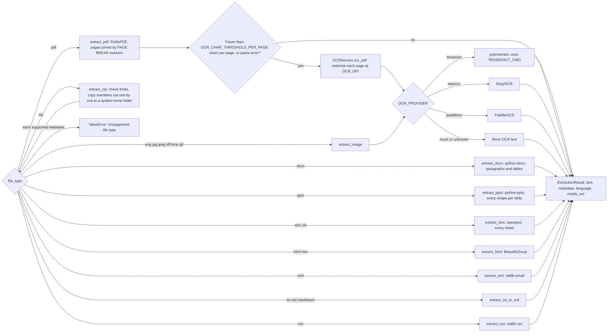

That is 19 extensions in 10 parser families. Pages are joined with a `--- PAGE BREAK ---` marker, which is how a citation can later name a page. The language is detected with `langdetect` and stored in `meta_data`.

### Archive limits

An archive is a description written by whoever made it, so `extract_zip` never calls `extractall()`. It checks each member and copies it out itself:

| Limit | Setting | Effect |
|---|---|---|
| Members | `ZIP_MAX_ENTRIES` (1000) | More, counting nested archives: the archive fails |
| Total expansion | `ZIP_MAX_TOTAL_UNCOMPRESSED_BYTES` (500 MB) | Checked against the declared sizes before anything is unpacked, then against the bytes actually written, counted while copying: over it, the archive fails. A member whose data does not match its declared size never yields more than declared and fails on its own |
| Compression ratio | `ZIP_MAX_COMPRESSION_RATIO` (100) | A member over 1 MB compressed beyond it fails the archive; small files are exempt, since short repetitive text compresses far past 100:1 harmlessly |
| Nesting | `ZIP_MAX_NESTING_DEPTH` (1) | A zip inside the upload is opened, with the same shared budget; a zip inside that is skipped and listed in `meta_data.skipped_entries` |
| Member names | always | Absolute paths, drive letters and `..` components are skipped and listed; members are written under random names in a `tempfile.mkdtemp` folder that is always removed |
| Encrypted members, symlinks | always | Skipped and listed |

Office files (`.docx`, `.pptx`, `.xlsx`) are zip archives too, and their parsers decompress into memory, so `_check_office_container` rejects one whose parts declare more than `ZIP_MAX_TOTAL_UNCOMPRESSED_BYTES` before its parser opens it. Python's `zipfile`, which all three libraries use, stops a part at its declared size, so the declared total is a real bound. The member-count and ratio limits do not apply to them: a 400-slide deck has about 1,600 parts and a document of identical table cells compresses past 100:1, both legitimately. Any of these violations raises `UnsafeArchiveError`, a permanent failure.

### Chunking

Text is split on page markers first, so every chunk records its page, then chunked with the strategy chosen at upload (default `fixed_size`, 500 tokens, 50 overlap). Tokens are counted with `tiktoken` (`cl100k_base`). `chunk_index` is continuous across the document; `page_number` is the page used for citations.

| Strategy | Splits on | Suited to |
|---|---|---|
| `fixed_size` | Sliding token window with overlap | Most documents (default) |
| `sentence` | Whole sentences packed to the token budget | Prose that should not be cut mid-sentence |
| `markdown` | `#` headers, across the whole document rather than per page | Wikis and structured notes |

### Embedding provider selection

`EMBEDDING_PROVIDER` decides how text becomes vectors. Questions must be embedded by the same model as the chunks, so changing provider requires re-processing every document. Gemini fails loudly; the other providers fall back to mock vectors.

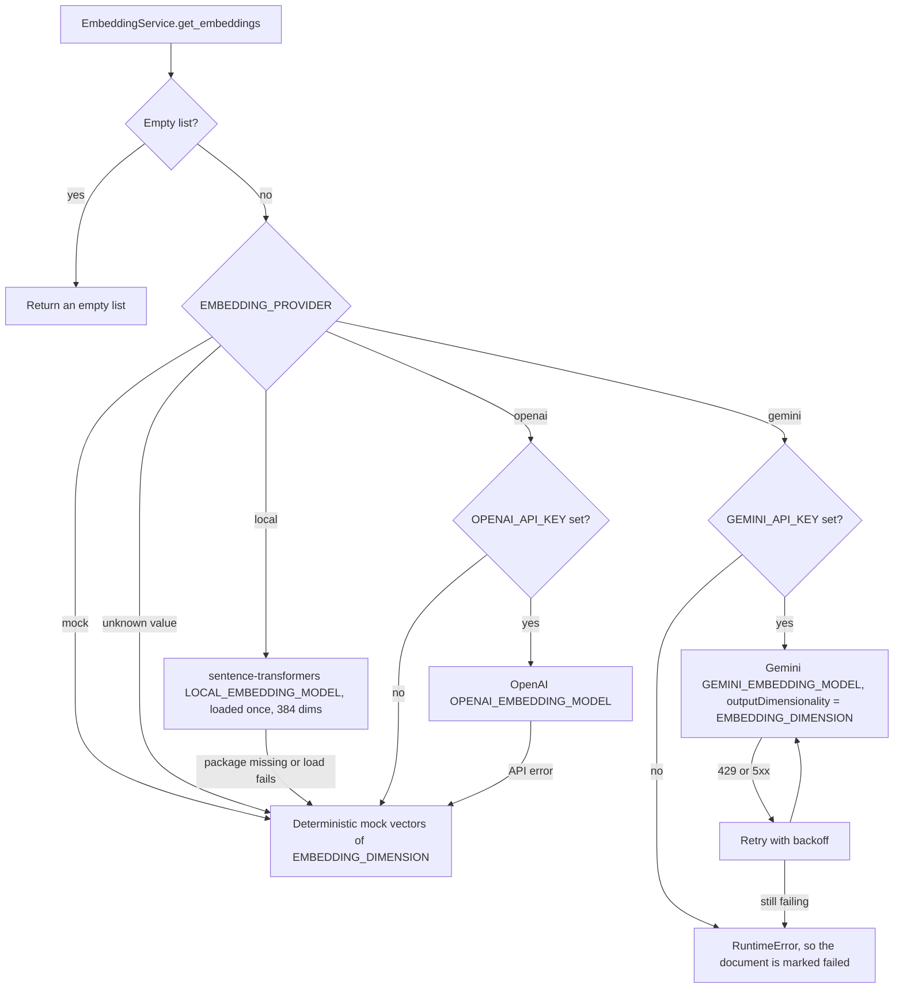

Every vector is stored with `model_name` (for example `all-MiniLM-L6-v2` or `gemini-embedding-001@384`), so rows from an old model can be identified.

### Celery task lifecycle

Only the document id crosses the queue. The diagnostic endpoints in `tasks.py` use the same broker and return `503` when `INGESTION_MODE=inline`.

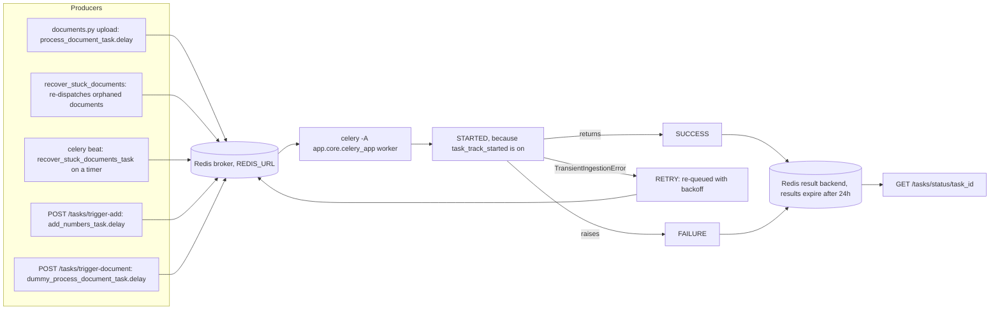

`process_document_task` records its own errors on the document, so its Celery state is normally `SUCCESS` even when the document is `failed`; check `Document.status`. Its options:

| Option | Value | Why |
|---|---|---|
| `autoretry_for` | `TransientIngestionError` only | The pipeline raises it for a transient failure with retries left; everything else is final |
| `max_retries` | `INGESTION_MAX_RETRIES` | The last attempt runs with `final_attempt=True`, so it fails the document instead of raising |
| `retry_backoff`, `retry_backoff_max`, `retry_jitter` | `INGESTION_RETRY_BACKOFF_SECONDS`, `INGESTION_RETRY_BACKOFF_MAX_SECONDS`, on | Waits of up to 10, 20, 40 s by default, each randomised so a recovered dependency is not stampeded. Long enough to outlast a per-minute rate limit or ClamAV reloading its definitions |
| `acks_late`, `reject_on_worker_lost` | on | The message survives a worker that dies mid-job |
| `soft_time_limit`, `time_limit` | `INGESTION_SOFT_TIME_LIMIT_SECONDS`, `INGESTION_TIME_LIMIT_SECONDS` | The soft limit fails the document with a timeout message; the hard limit kills the process if even that hangs |

The time limits rely on Unix signals, so they need the prefork pool. On Windows the worker needs `--pool=solo` because prefork requires `fork()`; retries and recovery still work there, the time limits do not.

---

## Answering questions

### Mode dispatch

`POST /api/v1/chat/sessions/{id}/messages` (and its streaming twin, see [Streaming answers](#streaming-answers)) shares authorisation, persistence and response shape between the two modes. The user message is saved before the model is called, so a failed generation still leaves the question in the transcript. Neither mode returns a 500 when the model is missing or fails.

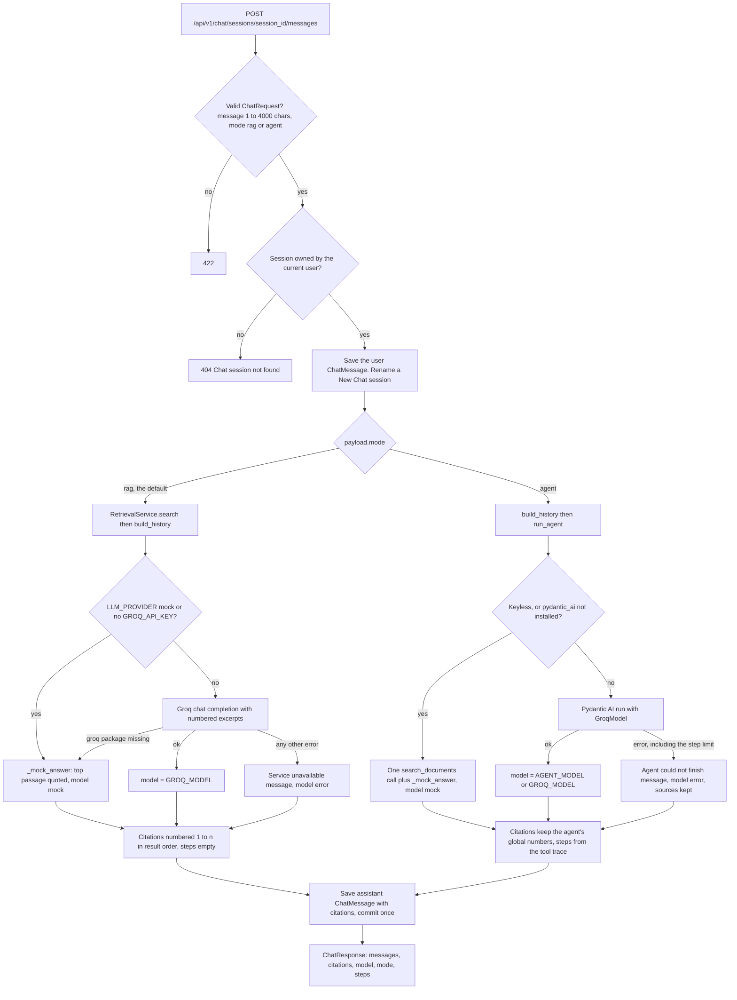

A session titled "New Chat" is titled after its first question (`make_title`: whitespace collapsed, cut at a word boundary near 60 characters). A title the user set with `PATCH /chat/sessions/{id}` is never replaced. Each assistant message is saved with its `mode`, the `model` that actually answered, and the agent's `steps`, so a conversation resumed from the history sidebar renders exactly as it did live. `document_ids` in the request limits retrieval (and every agent tool) to those documents; the tenant and project filters still apply to each id.

### Fast RAG pipeline (`mode: "rag"`)

One embedding, two SQL queries (vector and keyword), one model call -- plus one small rewrite call for a follow-up question when a key is set. The tenant and project filters are part of both queries.

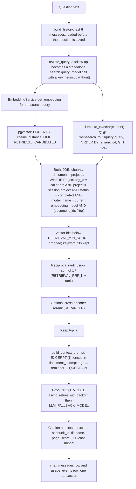

Before any of this, the endpoint checks the organisation's monthly token quota (`429` when used up) and the per-user chat rate limit. The question is sent to the model exactly once: history is loaded before the new message is saved, and `build_messages` also drops a trailing copy defensively.

Only the SEARCH uses the rewritten query; the model still receives the user's own words and the history, so the rewrite cannot change the question being answered. Its tokens are metered with the answer, and the query actually searched is returned as `search_query`.

Hybrid search exists for exact terms -- a policy number, a product code, a surname -- that embeddings blur. Reciprocal rank fusion merges the two rankings by position alone, because a cosine similarity and a `ts_rank_cd` live on scales that cannot be compared; a chunk near the top of both lists beats one at the top of only one. Every result keeps its cosine similarity as `score` (so the UI's "% match" means the same for every hit) and reports `match_type`: `vector`, `keyword` or `both`. `RETRIEVAL_HYBRID=false` restores vector-only search.

`top_k` defaults to `RETRIEVAL_TOP_K` (5) and a request may raise it to 20. If nothing survives the score threshold the prompt says `EXCERPTS: (none found)` and the system prompt makes the model answer with the not-found sentence. Answers stay grounded through the system prompt (no outside knowledge, no invented citations), the `RETRIEVAL_MIN_SCORE` cut-off, a temperature of 0.1, and citations that map each `[n]` to a real file and page.

---

## Streaming answers

`POST /api/v1/chat/sessions/{id}/messages/stream` takes the same body as the JSON endpoint and answers with Server-Sent Events, so the web UI can show the answer as it is written and, in agent mode, every research step the moment the agent takes it. Both endpoints run the same pipeline, `_answer_events` in `api/v1/chat.py`: an async generator of `(event, payload)` pairs. The JSON endpoint runs it to the end and returns the final `ChatResponse`; the SSE endpoint forwards every event. The two cannot disagree about how a question is answered, saved or metered.

| Event | Payload | When |
|---|---|---|
| `start` | `session_id`, `user_message_id`, `mode`, `title` | the question is saved (not yet committed) |
| `query` | `search_query`, `rewritten` | rag: the query retrieval used |
| `step` | `tool`, `args`, `summary` | agent: each tool call, as it happens |
| `citations` | `citations` | before the first token, so sources are on screen when the text cites them |
| `token` | `text` | the next piece of the answer |
| `done` | the full `ChatResponse` | after the commit |
| `error` | `detail` | something failed after the stream began; nothing was saved |

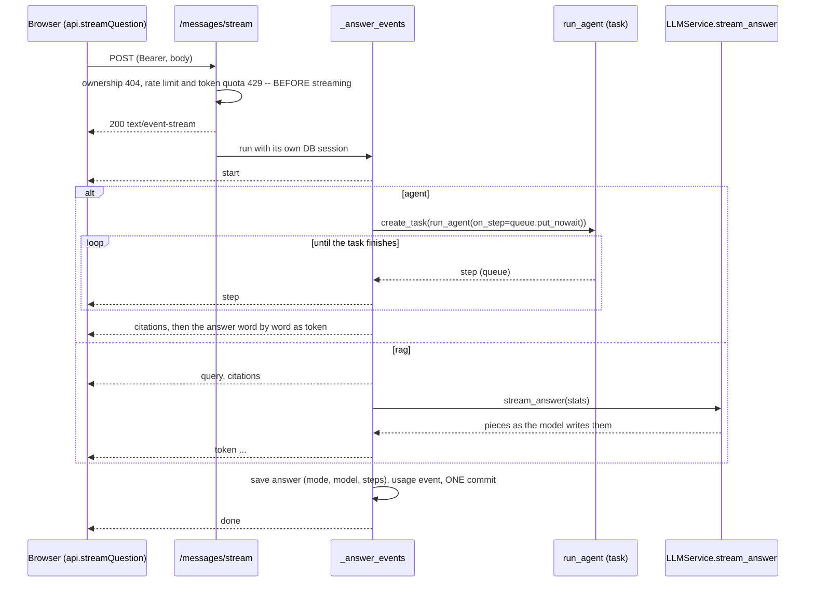

- **Refusals happen before the stream.** Once the `200` is sent its status cannot change, so everything that can be refused -- ownership, the rate limit, the token quota -- is checked in the handler first and arrives as an ordinary HTTP error.
- **The stream has its own database session.** The request's session belongs to the handler, which returns before the first byte is streamed; the generator opens and closes its own.
- **Saved at the end, or not at all.** The question, the answer and the usage event are committed together after the last token. A disconnect or an error mid-stream rolls everything back (and cancels a running agent), so a half-written answer is never stored.
- **Agent tokens are replayed.** The agent's tool loop produces its final text in one piece, so its answer is sent word by word after the steps; the steps themselves are live.
- **Token usage while streaming** comes from the provider's final chunk (`usage`, or Groq's `x_groq.usage`) through `stream_answer(stats=...)`.
- Responses carry `Cache-Control: no-cache` and `X-Accel-Buffering: no` so proxies do not buffer the stream into one late block.

---

## Agent mode

### Design

The fixed pipeline performs one search with the whole question. That handles direct questions well but struggles with multi-part questions or comparisons across files, where a single search matches neither half. Agent mode (`services/agent.py`) gives the model tools instead of a fixed set of excerpts. [Pydantic AI](https://ai.pydantic.dev) runs the loop: it builds tool schemas from typed Python functions, validates the model's arguments (an invalid argument becomes a retry, not a crash), executes the tools and enforces a usage limit. The model is Groq via `pydantic-ai-slim[groq]`.

| Tool | Arguments | Behaviour |
|---|---|---|
| `search_documents` | `query`, optional `document_id` | `RetrievalService.search`, optionally narrowed to one document |
| `list_documents` | none | Up to 50 of the project's documents, newest first, with id, type, page count and status |
| `read_document_section` | `document_id`, `start_chunk` (default 0), `count` (default 5, max 10) | Consecutive chunks of one `completed` document, in order |

- **Scoping.** Every tool is bound to the caller's `org_id` and the session's `project_id`, both taken from the authenticated request. The model chooses what to search for, never where. A document id from another tenant gets the same "not found" reply as one that does not exist.
- **Citation numbering.** Each run keeps one registry. The first time any tool surfaces a chunk it receives the next global number, and the model only sees excerpts labelled with those numbers (`EXCERPT [7] ...`), so `[7]` in the answer always means citation 7. A chunk seen twice keeps its first number. The response's citation list contains every surfaced chunk in first-seen order, so it may include excerpts the answer never cites.
- **Scores.** Chunks returned by `read_document_section` carry `score: 0.0`, because they were read rather than ranked.
- **Limits.** `AGENT_MAX_STEPS` (default 6) is passed as `UsageLimits(request_limit=...)`. Reaching it ends the run with an error answer.
- **Concurrency.** Tool calls from one model reply may run concurrently, so every tool takes `deps.lock` around database work; an `AsyncSession` cannot be shared by two coroutines.
- **Self-correction.** Invalid ids and empty results are returned to the model as readable sentences so it can adjust on the next step.
- **Fallbacks.** With no `GROQ_API_KEY`, `LLM_PROVIDER=mock`, or `pydantic-ai` not installed, the agent performs one `search_documents` call itself and returns the same demo answer as rag mode (`model: "mock"`). A failed run (rate limit, network error, invalid key, step limit) returns a readable message with `model: "error"` and keeps the citations already found.
- **Steps.** The tool trace is returned as `steps` (`{tool, args, summary}`) but not stored, so a reloaded conversation shows answers and citations without steps.
- **Testability.** `get_agent()` builds the `Agent` once (`lru_cache`) without a model; the model is supplied per run, which lets `tests/test_agent.py` drive the real agent and tools with a scripted Pydantic AI model and no Groq key.

### Agent loop

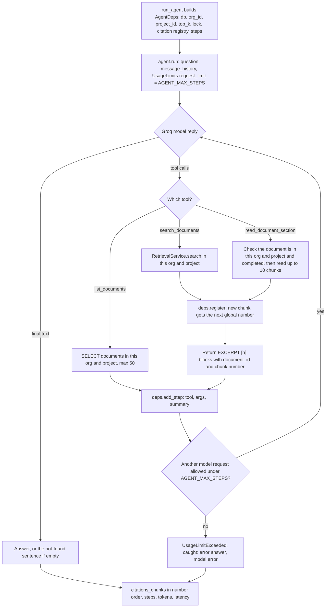

### Agent request sequence

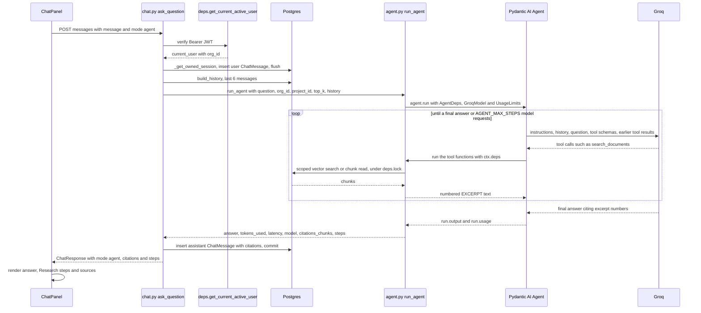

### Comparison

| | `rag` (Quick answer) | `agent` (Deep research) |
|---|---|---|
| LLM calls per question | 1 | Typically 2 to 6, capped by `AGENT_MAX_STEPS` |
| Searches | Exactly one, with the full question | As many as the model chooses, with its own queries |
| Latency and cost | Lowest | Several times higher; Groq rate limits arrive sooner |
| Predictability | Same steps every time | Varies by question; the step trace shows what happened |
| Best for | Direct questions answered in one place | Multi-part questions, cross-document comparisons, summaries, questions naming a file |

---

## Data model

Fifteen tables. Every row traces back to one organisation, which is what makes the `org_id` filter enforceable. Foreign keys cascade on delete, except `audit_logs.user_id` and `invites.invited_by`, which are `SET NULL` so the audit trail and pending invites survive a deleted user.

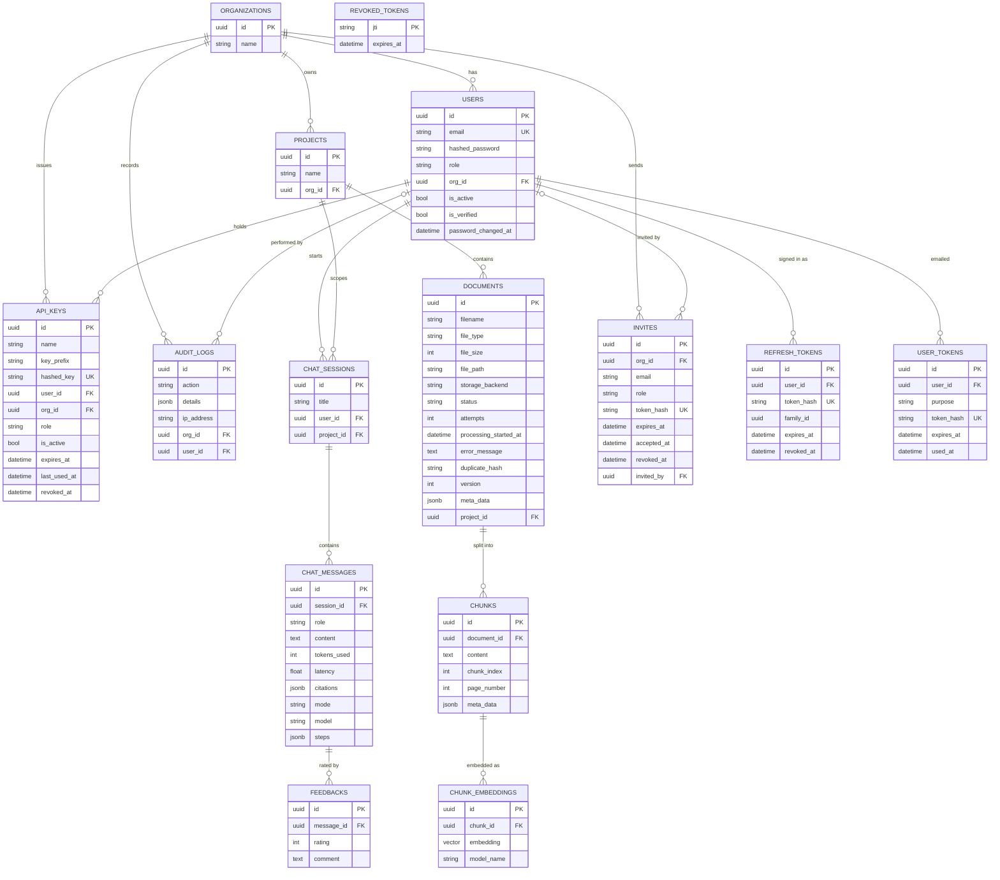

- `chunk_embeddings.embedding` is declared as `Vector(EMBEDDING_DIMENSION)` in the model, but the database column is `vector(384)`, fixed by migration `a1b2c3d4e5f6` (`EMBEDDING_DIM = 384`), with an HNSW `vector_cosine_ops` index. `EMBEDDING_DIMENSION` must match it; inserting a vector of a different length fails. A provider with a different output size (OpenAI `text-embedding-3-small` is 1536) needs a new Alembic migration that alters the column, then re-processing of every document.
- `duplicate_hash` (SHA-256 of the file content) is unique per `(project_id, duplicate_hash)`, not globally. The HNSW index, the `vector` extension and this constraint are defined in migration `a1b2c3d4e5f6_rag_vector_index.py`, not in the model files.
- `documents.meta_data` (JSONB) holds pipeline results: language, word and page counts, chunk count and strategy, embedding model, OCR use, processing time, `attempts`, `malware_scan` (the scanner that cleared the file, or `off`), and `error` when `failed`. A quarantined file also has `quarantined` and `malware_signature`; an archive lists `files_extracted` and `skipped_entries`. The attribute is named `meta_data` because `metadata` is reserved by SQLAlchemy.
- `documents.file_path` holds a storage key, `<project_id>/<uuid>.<ext>`, read through the backend named in `storage_backend` (`local` or `s3`). Rows from before migration `d4e6f8a0b2c5` hold an absolute path on disk, which `LocalStorage` still reads. `attempts` counts claims (the first run and every retry or recovery), `processing_started_at` is when the current claim was made, and `error_message` is the reason for `failed`, or for a retry while `pending`. `status` is indexed because the recovery sweep searches on it.
- `chat_messages.citations` (JSONB) stores the citations returned with each answer; `mode`, `model` and `steps` (JSONB, the agent's tool trace) record how it was produced. All three are empty on user messages and on answers saved before migration `a7b9c1d3e5f8`.
- `chunks` has a GIN index on the EXPRESSION `to_tsvector('english', content)` (migration `a7b9c1d3e5f8`), not a stored `tsvector` column: Postgres maintains it on insert, nothing had to be back-filled, and `retrieval.fts_document()` builds the identical expression so the planner can use it. It is not declared on the model because the SQLite test schema has no `to_tsvector`.
- Every token the server issues other than access tokens -- invite, refresh, reset, verification, API key -- is stored only as a SHA-256 hash. `revoked_tokens` holds access-token `jti`s until the token would have expired; logout prunes expired rows.
- `audit_logs` has a composite index on `(org_id, created_at)` for the audit log endpoint.

---

## Authentication and tenant isolation

Login returns a short-lived access token and a rotating refresh token. Every protected endpoint declares `Depends(deps.get_current_active_user)` or a role dependency built on it, so the endpoint body never runs for an invalid credential, and queries are filtered by `current_user.org_id`.

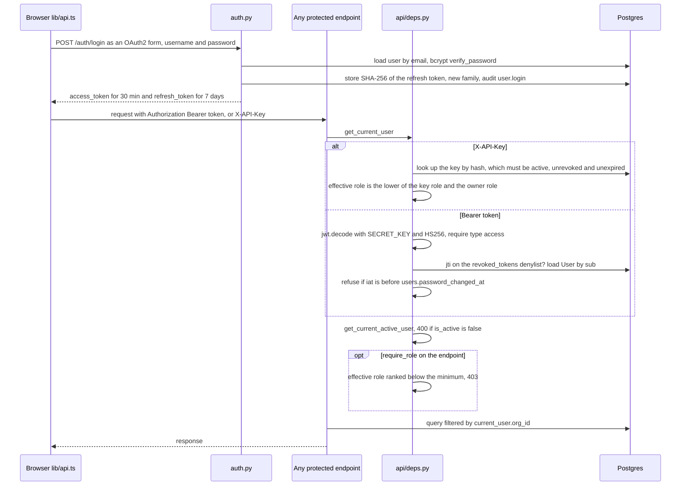

| | Access token | Refresh token |
|---|---|---|
| Lifetime | 30 minutes (`ACCESS_TOKEN_EXPIRE_MINUTES`) | 7 days (`REFRESH_TOKEN_EXPIRE_DAYS`) |
| Claims | user id, role, `org_id`, `type=access`, `jti`, `iat` | user id, `type=refresh`, `jti` |
| Server state | Denylisted by `jti` on logout | Row in `refresh_tokens` (hash, family, `revoked_at`) |
| Used for | Every request | `POST /auth/refresh` |

### Signup and invites

- Signup **without** an invite always creates a new organisation and makes the user its Admin. Any `role` in the body is ignored, and `org_id` without an invite is refused with `400`.
- Joining an existing organisation requires an invite token. An Admin creates the invite for one email address and one role (`POST /org/invites`); the token is emailed and returned once, and only its hash is stored. Signup with the token must use the same email; the role comes from the invite and the account is marked verified. Invites expire after `INVITE_EXPIRE_DAYS`, work once, and can be revoked.

### Roles

| Stored role | Alias | May |
|---|---|---|
| `Employee` | viewer | Read projects and documents, search, chat, rate answers |
| `Manager` | editor | Everything a viewer may, plus upload documents and create projects |
| `Admin` | admin | Everything an editor may, plus members, invites, API keys, the audit log and the task diagnostics |

`deps.require_role("editor")` admits that role and every role ranked above it; `require_viewer`, `require_editor` and `require_admin` are the three ready-made dependencies. The stored names are unchanged from earlier releases, so existing rows and tokens keep working. Endpoints for deleting and re-indexing documents should use `require_editor`.

### Sessions

- `/auth/refresh` revokes the presented refresh token and issues a new pair in the same family. Presenting an already-revoked token (a rotated or signed-out one) revokes the whole family, ending the session for both the legitimate user and whoever copied the token. Refresh tokens issued before migration `c3d5e7f9a2b4` have no row and are refused.
- `/auth/logout` denylists the access token's `jti` until its expiry and revokes the refresh token's family. It always returns `204`.
- A password reset sets `password_changed_at` and revokes every refresh token, so all existing sessions end. Deactivating or removing a member also revokes their refresh tokens; `is_active` stops their access tokens immediately.

### Passwords and email

- Policy (`security.password_problems`): at least `PASSWORD_MIN_LENGTH` (10) characters, not all digits, not the email address or its local part. Violations return `422` listing every problem.
- `POST /auth/password-reset/request` returns the same `202` body whether or not the email exists, and sends the email after the response. The single-use link expires after `PASSWORD_RESET_TOKEN_EXPIRE_MINUTES`.
- A self-service signup receives a verification link; `REQUIRE_EMAIL_VERIFICATION=true` makes login wait for it.
- Emails go to the API log unless `SMTP_HOST` is set. A sending failure is logged and never fails the request.

### API keys

Admins create keys with a name, a role (default viewer, never above their own) and an optional expiry. The key (`dm_...`) is returned once; the database keeps a 12-character prefix and the SHA-256 hash. Requests send it as `X-API-Key`. The request acts as the key's owner, scoped to the key's organisation, with the lower of the key's role and the owner's current role. `last_used_at` is updated at most every five minutes.

### Audit log

`services/audit.record` stages a row in the same transaction as the change it describes. Actions written: `user.signup`, `user.login`, `user.login_failed`, `user.logout`, `user.email_verified`, `password.reset_requested`, `password.reset`, `invite.create`, `invite.revoke`, `invite.accept`, `member.role_change`, `member.deactivate`, `member.reactivate`, `member.remove`, `document.upload`, `api_key.create`, `api_key.revoke` (and `document.delete` for a delete endpoint, which should call `audit.record` the same way). `GET /org/audit-logs` pages through them newest first with `limit`, `offset`, `action` (exact, or a prefix ending in `.`), `user_id`, `since` and `until`. The IP is `request.client.host`, so run uvicorn with `--proxy-headers` behind a proxy.

### Other rules

- The `type` claim is checked, so a refresh token cannot be used as an access token.
- An invalid, expired, signed-out or wrong-type credential returns `401`; an inactive account `400`; a role below the endpoint's minimum `403`.
- A row owned by another user or organisation returns `404`, not `403`, so its existence is not revealed. This includes members, invites and API keys on the admin endpoints.
- Path ids are typed `uuid.UUID`, so a malformed id is rejected with `422` before any query runs.
- Response models filter output, so fields such as `hashed_password`, token hashes and API key hashes cannot reach a client.
- With `ENV=production`, the app refuses to start if `SECRET_KEY` is the committed default or shorter than 32 characters, and `/api/v1/tasks/*` returns `404`. Elsewhere those diagnostics require an Admin.
- The frontend (`lib/api.ts`) stores both tokens. On a `401` it calls `/auth/refresh` once, through a single shared in-flight promise so simultaneous `401`s cannot present the same refresh token twice (which the backend would treat as theft), then retries the request; if the refresh fails the user is returned to `/login`. Signing out clears both tokens locally and calls `/auth/logout`. The screens for these flows (`/login?invite=`, `/forgot-password`, `/reset-password`, `/verify-email` and `/settings`) are described under [Frontend](#frontend).

---

## Limits, quotas and observability

### Middleware stack

Requests pass, outermost first, through CORS, `RequestContextMiddleware` (request id, logging context, access log), `SecurityHeadersMiddleware` and `UploadSizeLimitMiddleware`, then the router. Because the request context wraps everything below it, a `413` from the size limit or an unhandled crash still gets a request id and an access-log line, and CORS headers stay on every error.

### Rate limiting

`core/rate_limit.py` keeps two counters per caller and limit (this window and the previous one) and estimates the last full window as `previous x (fraction still in view) + current`, which avoids the burst a fixed window allows at its boundary. A refused request is not counted, so a client that ignores `Retry-After` is still admitted at exactly the configured rate. Counters live in Redis (one atomic pipeline per request, keys expiring after two windows) when it answers, and in process memory otherwise; a Redis failure switches to memory for 30 seconds and is logged once.

| Limit | Keyed by | Endpoints |
|---|---|---|
| `RATE_LIMIT_LOGIN` | client IP | `POST /auth/login` |
| `RATE_LIMIT_SIGNUP` | client IP | `POST /auth/signup` |
| `RATE_LIMIT_PASSWORD_RESET` | client IP | `POST /auth/password-reset/request` and `/confirm` |
| `RATE_LIMIT_CHAT` | user | `POST /chat/sessions/{id}/messages` |
| `RATE_LIMIT_SEARCH` | user | `POST /search/` |
| `RATE_LIMIT_UPLOAD` | user | `POST /documents/upload` |

The per-user limits depend on authentication, so an unauthenticated request is answered `401` and never counted. The client IP comes from `core/client_ip.py`, which believes `X-Forwarded-For` only as far as `TRUSTED_PROXY_COUNT` says proxies you control wrote it.

### Metering and quotas

Each chat answer stages one `usage_events` row (mode, the model that actually answered, prompt and completion tokens, estimated cost from `LLM_PRICING`, request id) in the same transaction as the answer. Quotas are per organisation, from the `QUOTA_*` settings unless the organisation row overrides them (NULL = setting, 0 = unlimited):

| Quota | Checked | Over it |
|---|---|---|
| Monthly tokens (calendar month, UTC) | Before the question is saved or a model is called | `429` with `Retry-After` until the 1st |
| Documents held | For each new, non-duplicate file before it is stored | `402`; files stored earlier in the request are removed |
| Storage bytes | Same | `402` likewise |

The token check is soft at the edge: a request made with a few tokens left may finish a little over, and the next is refused, so no answer is ever cut off. `GET /org/usage` (admin) reports the month by model and by mode with all three quotas.

### Language model robustness

`llm.py` calls Groq through `AsyncGroq` with the SDK's own retries disabled. Transient failures (`408`, `409`, `429`, `5xx`, connection errors) are retried on the same model up to `LLM_MAX_RETRIES` times with exponential backoff from `LLM_RETRY_BACKOFF_SECONDS`, honouring `Retry-After` up to 20 seconds. Timeouts (`LLM_TIMEOUT_SECONDS`), exhausted retries and retired models (`model_decommissioned`, `404`) move to `LLM_FALLBACK_MODEL` if one is set. Bad keys and malformed requests fail at once. If every model fails, the answer is an apology with `model="error"` and the excerpts still listed as sources.

Document text is untrusted. Every excerpt, in rag prompts and in all agent tool output, is wrapped in `<document_excerpt>` tags with the uploader-controlled filename cleaned and any tag look-alike inside the text escaped, so an excerpt cannot close its own block. Both system prompts carry a rule that tagged text is data and instructions inside it must not be followed, and the rag prompt repeats it after the excerpts. The real boundary remains tenant isolation in the SQL: an injected instruction can only ever reach its own organisation's answers.

Retrieval compares only vectors whose `model_name` matches the current embedding model, so after a provider or model change older documents stop matching (until re-processed) instead of being compared across incompatible vector spaces.

### Logging, errors and health

Every log line is one JSON object (`LOG_FORMAT=json`) with time, level, logger and message, plus the request context (`request_id`, and `user_id` / `org_id` once authenticated) or, in the worker, `task_id`, `task` and `document_id`. Uvicorn's own loggers are routed through the same formatter and its access log is replaced by the richer one. The access line records the route template rather than the URL, so tokens in paths and query strings never reach the logs.

Sentry is optional: with `SENTRY_DSN` set, the API (Starlette/FastAPI integrations) and the worker and beat (Celery integration) report errors tagged with the component, request id and organisation, with `send_default_pii=False`.

| Endpoint | Checks | Fails with |
|---|---|---|
| `GET /api/v1/health` | Nothing (liveness) | Never fails while the process runs |
| `GET /api/v1/health/ready` | Database always; Redis; a Celery worker ping only with `INGESTION_MODE=celery` | `503` when the database is down, or Redis or the worker in Celery mode; Redis down in inline mode is reported but not fatal |

---

## API surface

Interactive OpenAPI docs are served at `/docs`. Everything except signup, login, refresh, logout, invite preview, password reset, email verification and the health checks requires `Authorization: Bearer <token>` or `X-API-Key: <key>`.

| Method | Path | Purpose |
|---|---|---|
| `POST` | `/api/v1/auth/signup` | Create a user. Without `invite_token`: a new organisation (optional `org_name`) with the user as Admin. With `invite_token`: join the inviting organisation with the invited role |
| `POST` | `/api/v1/auth/login` | OAuth2 password form (`username`, `password`), returns access and refresh tokens |
| `POST` | `/api/v1/auth/refresh` | Rotate a refresh token for a new pair |
| `POST` | `/api/v1/auth/logout` | Denylist the bearer access token and revoke the refresh token in the body (`refresh_token`); always `204` |
| `GET` | `/api/v1/auth/invites/{token}` | Invite preview: email, role, organisation name, expiry |
| `POST` | `/api/v1/auth/password-reset/request` | Email a reset link (`email`); same `202` whether or not the account exists |
| `POST` | `/api/v1/auth/password-reset/confirm` | Set a new password (`token`, `new_password`); ends all sessions |
| `POST` | `/api/v1/auth/verify-email` | Confirm an email address (`token`) |
| `POST` | `/api/v1/auth/verify-email/resend` | Send a new verification email to the signed-in user |
| `GET` | `/api/v1/users/me` | The current user |
| `GET` / `POST` | `/api/v1/projects/` | List projects / create one (editor or admin; audited) |
| `GET` | `/api/v1/projects/{id}` | One project with `document_count` and `ready_count` |
| `GET` | `/api/v1/projects/{id}/embedding-map` | 3D PCA projection (numpy, server-side) of up to 2000 chunk embeddings, with document ids and snippets, for the search page's point cloud (viewer+) |
| `PATCH` / `DELETE` | `/api/v1/projects/{id}` | Rename (`name`) / delete with its documents, chunks, stored files and conversations (editor or admin; audited) |
| `GET` | `/api/v1/org/members` | Members of the organisation (admin) |
| `PATCH` / `DELETE` | `/api/v1/org/members/{id}` | Change `role` / `is_active`, or remove a member (admin; not yourself, never the last admin) |
| `POST` / `GET` | `/api/v1/org/invites` | Invite an email with a role (token returned once) / list invites with status (admin) |
| `DELETE` | `/api/v1/org/invites/{id}` | Revoke a pending invite (admin) |
| `POST` / `GET` | `/api/v1/org/api-keys` | Create a key (`name`, `role`, `expires_in_days`; key returned once) / list keys (admin) |
| `DELETE` | `/api/v1/org/api-keys/{id}` | Revoke a key (admin) |
| `GET` | `/api/v1/org/audit-logs` | Audit entries, newest first; `limit`, `offset`, `action`, `user_id`, `since`, `until` (admin) |
| `GET` | `/api/v1/org/usage` | This calendar month's chat usage: requests, tokens in and out, estimated cost, by model and by mode, and the token, document and storage quotas (admin) |
| `GET` | `/api/v1/org/feedback?days=` | Answer ratings over the last `days` (default 30): totals, satisfaction, by mode and by model, and the 20 most recent thumbs-down answers with their questions (admin) |
| `POST` | `/api/v1/documents/upload` | Multipart upload (`project_id`, `files`, optional `chunk_strategy`, `chunk_size`, `chunk_overlap`), editor or admin; returns `202` with `pending` rows. `413` too large, `415` unsupported or mismatched content, `422` chunk options out of range, `402` document or storage quota reached, `429` rate limited, `503` storage unreachable |
| `GET` | `/api/v1/documents/?project_id=` | Documents with status, `error_message`, `attempts` and processing metadata |
| `GET` | `/api/v1/documents/{id}` | One document |
| `PATCH` | `/api/v1/documents/{id}` | Rename (`filename`, cleaned like an upload name; the real extension is kept) (editor or admin; audited) |
| `DELETE` | `/api/v1/documents/{id}` | Delete the row, its chunks and vectors (cascade) and then the stored file (editor or admin; audited) |
| `POST` | `/api/v1/documents/{id}/reindex` | Process the stored file again, optionally with new `chunk_strategy` / `chunk_size` / `chunk_overlap`; `202`, `409` while queued or processing, `410` if quarantined (editor or admin; audited; upload rate limit) |
| `GET` | `/api/v1/documents/{id}/chunks?around=&window=` | The cited chunk and up to 5 neighbours each side (or the start of the document), for the citation viewer; `404` for a chunk that no longer exists |
| `GET` | `/api/v1/documents/{id}/preview` | The original file, as an attachment under its original name with `nosniff`; HTML is served as `text/plain`, and a type outside the allowlist (possible only for rows uploaded before it existed) as `application/octet-stream`. `409` while scanning is on and the file has not been cleared, `410` if quarantined, `404` if the stored file is gone |
| `POST` | `/api/v1/search/` | Hybrid search only: chunks with scores and `match_type`, no LLM; optional `document_ids` (up to 50) |
| `POST` / `GET` | `/api/v1/chat/sessions` | Start a conversation in a project / list your sessions (optional `?project_id=`) |
| `PATCH` | `/api/v1/chat/sessions/{id}` | Rename a conversation (`title`) |
| `GET` | `/api/v1/chat/sessions/{id}/messages` | Transcript, with each answer's citations, `mode`, `model` and `steps` |
| `GET` | `/api/v1/chat/sessions/{id}/export` | The conversation as a Markdown attachment |
| `POST` | `/api/v1/chat/sessions/{id}/messages` | Ask a question: `message` (1-4000 chars), optional `top_k` (1-20), optional `mode` (`rag` or `agent`), optional `document_ids` (up to 50). `429` when rate limited or the monthly token quota is used up |
| `POST` | `/api/v1/chat/sessions/{id}/messages/stream` | The same, answered as Server-Sent Events (see [Streaming answers](#streaming-answers)) |
| `DELETE` | `/api/v1/chat/sessions/{id}` | Delete a conversation |
| `POST` | `/api/v1/chat/messages/{id}/feedback` | Rate an answer (`1` or `-1`) |
| `POST` | `/api/v1/tasks/trigger-add`, `/api/v1/tasks/trigger-document` | Queue diagnostics (admin; `503` in inline mode; `404` with `ENV=production`) |
| `GET` | `/api/v1/tasks/status/{task_id}` | Celery task state (admin; `404` with `ENV=production`) |
| `GET` | `/`, `/api/v1/health` | Liveness and configuration report (LLM provider, model, whether a key is configured, embedding settings) |
| `GET` | `/api/v1/health/ready` | Readiness: per-component status of the database, Redis and (Celery mode) a worker; `503` when a hard dependency is down |

Every response carries `X-Request-ID` and the security headers. Rate-limited endpoints also return `X-RateLimit-Limit` and `X-RateLimit-Remaining`, and `Retry-After` with a `429`.

Search and chat are deliberately separate: search shows exactly what retrieval returned, which distinguishes a retrieval problem from a generation problem.

---

## Frontend

The frontend is a Next.js 16 / React 19 client of the API with no server-side data access. Interactive pages and components are client components (`"use client"`).

- **One API client.** Components never call `fetch` directly. `apiFetch` in `lib/api.ts` attaches the bearer token when present, unwraps FastAPI's `detail` (string or validation-error array) into a readable message, and returns `{}` for `204`. `login` (OAuth2 form encoding) and `uploadDocuments` (`FormData`, browser-set multipart boundary) bypass it by necessity but share its error handling.
- **Silent refresh.** On a `401`, `apiFetch` (and `uploadDocuments`) trades the stored refresh token for a new pair and retries the request once. Simultaneous `401`s share one refresh promise, because the backend treats a refresh token presented twice as stolen and ends the session. If the refresh fails, both tokens are cleared and the browser is sent to `/login`. `logout` clears both tokens first, then asks `/auth/logout` to revoke them (best effort, `keepalive`).
- **Errors keep their status.** Failures are thrown as `ApiError` (an `Error` with `status` and `retryAfter`). `getErrorMessage` appends "Try again in ..." to a `429` whose text does not already say when, so chat and search show rate-limit and token-quota waits. `UploadZone` prefixes `413`, `415`, `429`, `402` and `503` with what kind of problem it is. The API lists `Retry-After` and `X-Request-ID` in CORS `expose_headers`; without that the browser hides them.
- **Role-aware interface.** `useCurrentUser` loads `/users/me`; `lib/roles.ts` hides "New project" and the upload zone from viewers and the settings tabs from non-admins, accepting both role spellings and failing closed while the role is unknown. The API enforces every rule regardless.
- **Password hints.** `lib/password.ts` mirrors `password_problems` (minimum length, not digits only, not the email), shown live under the signup and reset fields. The minimum is `NEXT_PUBLIC_PASSWORD_MIN_LENGTH` (default 10) and should match the backend's `PASSWORD_MIN_LENGTH`.
- **Email links.** The routes match the links in `backend/app/services/email.py`: `/login?invite=`, `/reset-password?token=` and `/verify-email?token=`. Change both sides together.
- **Security headers.** `next.config.mjs` sends, on every route, a Content-Security-Policy (`default-src 'self'`; `connect-src` adds only the origin of `NEXT_PUBLIC_API_URL`; `frame-ancestors`, `object-src` `'none'`; `'unsafe-inline'` scripts for Next's hydration, `'unsafe-eval'` and websockets in development only; `upgrade-insecure-requests` when the API is HTTPS), `X-Frame-Options: DENY`, `Referrer-Policy: strict-origin-when-cross-origin`, a `Permissions-Policy` disabling camera, microphone, geolocation, payment and USB, `X-Content-Type-Options: nosniff`, and HSTS in production builds. A nonce-based CSP would force every page to render dynamically, so it was not used.
- **Hand-written types.** The interfaces in `lib/api.ts` mirror `backend/app/schemas/` and must be updated by hand when a schema changes; the end-to-end suite is what detects drift.
- **Token storage.** The access token is stored in `localStorage` behind a `typeof window` guard, since components also render on the server. Client-side route guards are a convenience; the API enforces authorisation.
- **Status polling.** The project page polls the document list every 3 seconds while any document is `pending` or `processing`, stops when all have settled, and clears the interval on cleanup. A `failed` document shows its `error_message` (falling back to `meta_data.error`), and a `pending` one with an `error_message` shows that it is waiting to be retried.
- **Optimistic, streamed chat.** A question and an empty answer bubble are appended with temporary ids; streamed tokens and steps are written into the bubble as they arrive; both are replaced by the saved messages on `done`, and both are removed on failure or Stop (an `AbortController` cancels the `fetch`, and the backend saves nothing).
- **SSE over fetch.** `EventSource` can only `GET` and cannot send a bearer token, so `api.streamQuestion` POSTs with `fetch`, reads the body stream, and `parseSseBuffer` splits complete events from a partial tail that waits for the next read.
- **History.** A conversation is created on its first question, not when the tab opens, so the sidebar never fills with empty "New Chat"s. Selecting one loads its transcript; rename is inline and delete asks for a second click.
- **Citation viewer.** "View" on a citation (or a search result) opens `SourceViewer`. A PDF is fetched through the authenticated `/preview` endpoint and drawn by pdf.js at the cited page; the text runs that appear in the snippet are painted over. pdf.js is imported only when a PDF is opened, runs its worker on the main thread (the CSP allows scripts from `'self'` only) and never uses `eval`. Other types -- and PDFs on request or failure -- show the extracted text around the cited chunk with the passage in a `<mark>`, found by whitespace- and case-insensitive matching (`lib/highlight.ts`).
- **Bulk upload.** `UploadZone` sends one request per file, three at a time, through `api.uploadFile` (XMLHttpRequest, the only browser API with upload progress), so one rejected file is one red row while the rest succeed.
- **Copy and export.** Each answer copies as Markdown with its sources; Export downloads the whole conversation as a `.md` file built in the browser (`lib/export.ts`, the same layout as the backend's `/export`).

### Chat mode flow

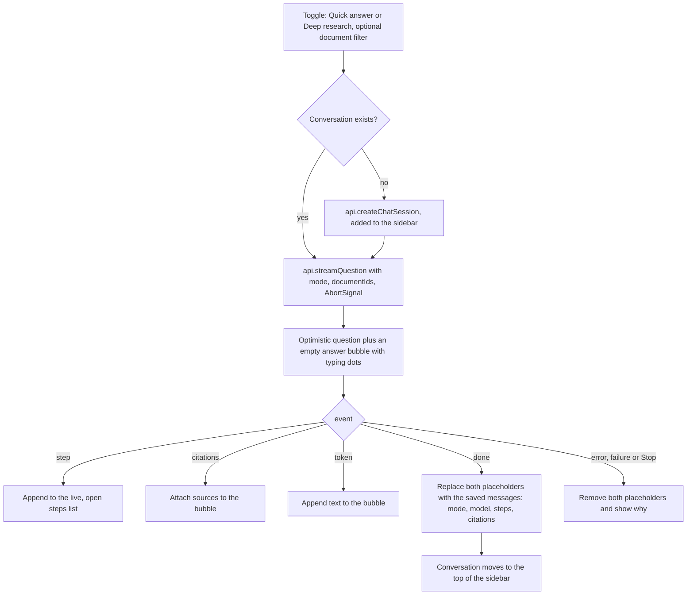

The mode is component state only (default Quick answer) and resets on reload. Steps live on the message itself (`ChatMessageItem.steps`) because the backend now saves them.

---

## Answer quality

Two complementary signals, one from real users and one reproducible.

**Feedback.** The thumbs under every answer (`POST /chat/messages/{id}/feedback`) are summarised for admins by `GET /org/feedback` and the Settings > Feedback tab: satisfaction (up / (up + down)), the split by mode and by model, and the recent thumbs-down answers with their questions and comments. Feedback has no `org_id`; it is scoped by joining message -> session -> project -> organisation.

**Evaluation harness** (`backend/app/eval`). A golden set is a JSON file of questions with the documents (and optionally snippets) that should answer them:

```json
{ "name": "HR handbook", "top_k": 5, "cases": [
  { "id": "leave", "question": "How many days of annual leave?",
    "expected_documents": ["handbook.pdf"], "expected_snippets": ["25 days"],
    "expected_keywords": ["25"] } ] }
```

`python -m app.eval --golden <file> --project-id <uuid>` runs every question through the real `RetrievalService.search` and reports:

| Metric | Meaning | Needs |
|---|---|---|
| hit rate | share of questions with at least one relevant result in the top k (for a case with no `expected_documents`, a hit means nothing came back) | nothing |
| MRR | mean of 1 / rank of the first relevant result | nothing |
| keyword rate | share of answers containing every `expected_keywords` entry (`--answers`) | nothing (mock answers without a key) |
| faithfulness | 0..1 from an LLM judge: is every claim supported by the excerpts? (`--answers`) | `GROQ_API_KEY`; reported as `n/a` without one rather than faked |

Retrieval and generation are scored separately because a wrong answer has two possible causes with different fixes. `--no-hybrid` compares against vector-only search, `--output` writes the JSON report, and `--min-hit-rate` exits non-zero below a threshold for use as a CI gate. The harness takes its search, answer and judge functions as arguments, which is how `tests/test_retrieval_quality.py` runs it with no database or model.

---

## CI pipeline

`.github/workflows/ci.yml` runs on every pull request and on pushes to `main`.

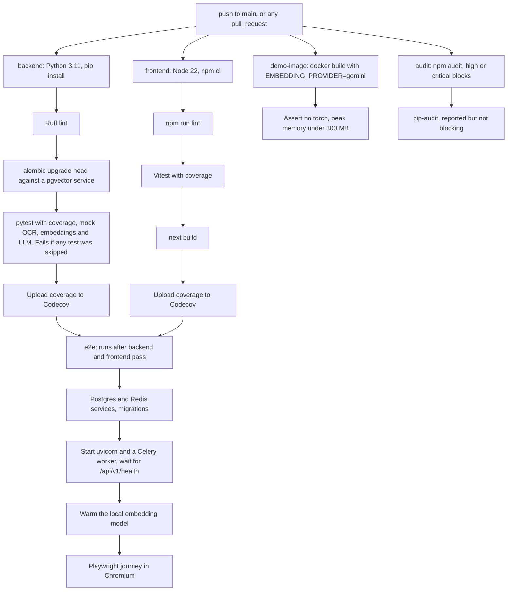

Separate workflows cover CodeQL, Trivy image scanning, OpenSSF Scorecard, Dependabot auto-merge, PR labelling, release drafting, stale issues, AI issue triage and PR review, an uptime check, and a welcome message for new contributors.

---

## Deployment topology

Locally, `backend/docker-compose.yml` provides Postgres and Redis, plus ClamAV behind the `scan` profile (`docker compose --profile scan up -d`); the API, worker and frontend run directly. The hosted demo replaces the worker and Redis with inline ingestion and uses managed Postgres and hosted embeddings; its files stay on the container's disk unless `STORAGE_BACKEND=s3` points it at a bucket. See [DEPLOYMENT.md](DEPLOYMENT.md), which also covers object storage, scanning and backups.

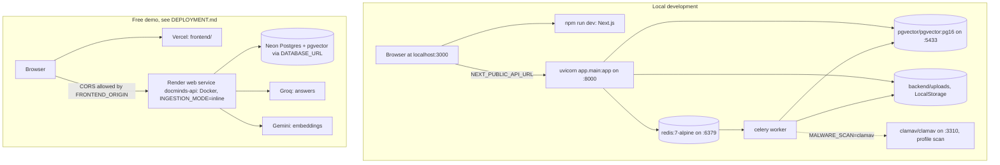

---

## Design decisions

**pgvector instead of a separate vector database.** Vector search is an ordinary SQL query, so it joins up to `projects` and filters on `org_id` inside the query: tenant isolation is part of the query rather than a post-filter. One database also means one backup, one connection pool and one transaction for chunks, vectors and status.

**Text and vectors in separate tables.** `chunks` holds text and `chunk_embeddings` holds vectors with a `model_name`. Re-embedding replaces vectors without touching text, several models can coexist during a migration, and text queries do not load vector data.

**HNSW rather than IVFFlat.** HNSW can be built on an empty table and stays accurate as rows arrive; IVFFlat needs existing data and periodic rebuilds. HNSW costs more memory and build time.

**Keeping the fixed pipeline alongside the agent.** Most questions are direct; one search and one call is faster, cheaper, deterministic and easier to debug. The agent reuses the same retrieval function as a tool, so it is a layer on top rather than a replacement.

**Idempotent ingestion.** Existing chunks are deleted before new ones are inserted, so re-running the task cannot duplicate chunks.

**A claim in the database, not trust in the queue.** `acks_late` means a message can be delivered more than once, and the recovery sweep re-queues work it cannot prove is alive. Rather than trying to make delivery exactly-once, which Redis cannot offer, every run first claims the document with one conditional `UPDATE`. Duplicates then cost one query and skip, and the database stays the single source of truth for who is processing what.

**Retry only what can succeed.** Retrying a corrupt file three times only delays the `failed` the user is waiting for, so failures are split into transient and permanent, and anything unrecognised is permanent. Transient errors are recognised by exception class name, so the pipeline needs no import from OpenAI, Google, botocore or asyncpg to classify theirs.

**Server-chosen storage keys.** The client's filename is attacker-controlled text, so it is kept only for display. Stored objects are named `<project_id>/<uuid>.<ext>`, which removes path traversal, collisions and reserved names in one step, and works unchanged on a disk or in a bucket. Each document records its backend, so moving from `local` to `s3` needs no data migration.

**Validate before storing, and refuse the whole request.** All files are checked before any is written, so a rejected request leaves no orphaned objects or rows and the client never has to work out which half succeeded. The allowlist is derived from the extractor's own list, so a format is accepted exactly when there is a parser for it.

**Scanning fails closed.** When `MALWARE_SCAN=clamav`, a clamd outage delays processing instead of skipping the scan, and the preview endpoint refuses a file the scan has not cleared. An optional control that turns itself off whenever its dependency is down would protect nothing on the day it mattered.

**clamd's protocol, not a client library.** `INSTREAM` is a few lines over a socket, and the Python clamd clients have been unmaintained for years. Implementing it directly removes a dependency and lets the tests run it against a fake daemon on a loopback socket.

**Proxying previews instead of pre-signed URLs.** Streaming S3 objects through the API keeps the bucket private, needs no CORS configuration on it, and leaves the endpoint's ownership check as the only way to a file.

**`NullPool` on the database engine.** Each Celery task calls `asyncio.run()`, creating and closing an event loop. asyncpg connections are bound to the loop that created them, so a pooled connection reused in a later loop fails with `Event loop is closed`.

**Per-project deduplication.** A global unique constraint on `duplicate_hash` would prevent one organisation from uploading a file another already holds, and would reveal that it does. A migration replaced it with a `(project_id, duplicate_hash)` constraint.

**Sliding-window counters, with memory as the fallback.** A rate limiter that fails the request when Redis is down would turn a cache outage into a full outage, so the limiter degrades to per-process counting and says so once. Two integers per caller and limit give near-exact sliding-window behaviour without storing a timestamp per request.

**Usage as rows, not a running total.** One row per answer can be summed by month, model, mode or user after the fact and audited line by line; a counter column can only answer the question it was built for. The composite `(org_id, created_at)` index keeps the per-request quota check a short range scan.

**402 for storage, 429 for tokens.** The token quota resets on the 1st, so it behaves like a rate limit with a known `Retry-After`. Document and storage quotas never free themselves, so they use the status that means "you need a bigger plan".

**Liveness separate from readiness.** A liveness probe that queried the database would have the platform restart every API instance during a database outage, fixing nothing. Only readiness checks dependencies, concurrently and with a timeout each, so the probe itself can never hang.

**Hybrid search fused by rank, not by score.** Embeddings miss exact identifiers; full-text search misses paraphrase. Running both and merging with reciprocal rank fusion needs no weights to tune, because RRF ignores the incomparable raw scores. The keyword half reuses the same tenant-scoped joins as the vector half (one `scoped()` helper), so it cannot become a way around the `org_id` filter.

**Rewrite the search, not the question.** A follow-up is rewritten into a standalone query for retrieval only. The model still answers the user's own words with the history in front of it, so a poor rewrite costs recall at worst, never a subtly different answer.

**One pipeline, two transports.** The JSON and SSE chat endpoints both drain the same async generator. Streaming was added without a second copy of the authorisation, persistence and metering code that a second code path would have needed -- and would eventually have let drift.

**Persist the answer only when it is complete.** Saving tokens as they stream would leave half-answers in the history after every disconnect. Committing once at the end keeps the question, the answer and its usage event one atomic fact.

**Bulk upload as many single uploads.** The upload endpoint keeps its all-or-nothing rule (right for API clients); the browser sends files one at a time, three in parallel, so a person dropping a folder gets per-file progress and per-file errors.

**pdf.js on the main thread.** A worker would need a separate script URL that the bundler must emit and the CSP must allow; for rendering one cited page the main-thread cost is negligible, and no CSP relaxation was needed.

**Low temperature and a score threshold.** `LLM_TEMPERATURE=0.1` keeps answers close to the excerpts, and `RETRIEVAL_MIN_SCORE` discards weak matches so the system can answer "not found" instead of answering from unrelated text.
