# Architecture

Technical reference for DocMinds: how the components fit together, how a document becomes searchable, how a question is answered in each chat mode, and why the main design choices were made. For setup and configuration see [DEVELOPMENT.md](DEVELOPMENT.md); for hosting see [DEPLOYMENT.md](DEPLOYMENT.md).

## Contents

1. [System overview](#system-overview)
2. [Module reference](#module-reference)
3. [Ingestion pipeline](#ingestion-pipeline)
4. [Answering questions](#answering-questions)
5. [Agent mode](#agent-mode)
6. [Data model](#data-model)
7. [Authentication and tenant isolation](#authentication-and-tenant-isolation)
8. [API surface](#api-surface)
9. [Frontend](#frontend)
10. [CI pipeline](#ci-pipeline)
11. [Deployment topology](#deployment-topology)
12. [Design decisions](#design-decisions)

---

## System overview

The browser only talks to FastAPI. FastAPI either processes an upload itself (`INGESTION_MODE=inline`) or hands it to a Celery worker through Redis (`INGESTION_MODE=celery`, the local default). Both processes run the same services against the same Postgres database.

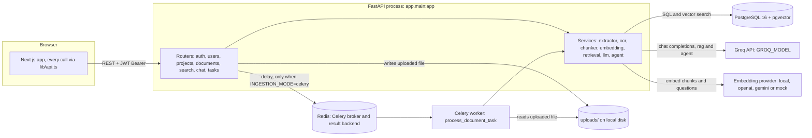

The API and worker share the database and the `uploads/` folder, so they must run on the same filesystem. Only the document id crosses the queue, never the file.

---

## Module reference

Services contain all domain logic and never import FastAPI, so the same function runs from an endpoint, a Celery task or a script. Endpoints stay thin: authorise, validate, call a service, shape the response.

### Backend (`backend/app/`)

| Layer | File | Responsibility |
|---|---|---|
| Entry point | `main.py` | Builds the FastAPI app, CORS, mounts routers, `GET /` and `GET /api/v1/health` |
| `core/` | `config.py` | Every setting, read once from the environment / `backend/.env` via pydantic-settings and validated at startup |
| | `security.py` | bcrypt password hashing (passlib); JWT creation with `type`, `jti` and fractional `iat` claims; opaque token and API key generation and SHA-256 hashing; the password policy |
| | `roles.py` | The role ranking `Admin` (admin) > `Manager` (editor) > `Employee` (viewer), and the generic aliases |
| | `celery_app.py` | The Celery app; Redis as broker and result backend, `task_track_started`, results expire after 24 h |
| `db/` | `session.py` | Async engine (asyncpg, `NullPool`) and `SessionLocal` (`expire_on_commit=False`, `autoflush=False`) |
| | `base_class.py` | Declarative `Base`; derives plural snake_case table names from class names |
| | `migrations/` | Alembic revisions: initial schema; then `a1b2c3d4e5f6`: `vector` extension, embedding column fixed at `vector(384)` (existing embeddings deleted), HNSW index, per-project dedup constraint; then `c3d5e7f9a2b4`: invites, refresh tokens, access-token denylist, emailed tokens, API key roles, `users.password_changed_at`, audit index |
| `models/` | `organization.py`, `user.py`, `project.py`, `document.py`, `chunk.py`, `chat.py`, `api_key.py`, `audit.py`, `invite.py`, `refresh_token.py`, `revoked_token.py`, `user_token.py` | 15 SQLAlchemy tables, UUID primary keys, cascading foreign keys |
| `schemas/` | `user.py`, `token.py`, `organization.py`, `project.py`, `document.py`, `account.py` | Pydantic request/response shapes (`Base` / `Create` / `Update` / `Out`); `*Out` use `from_attributes=True`. `account.py` covers reset, verification, members, invites, API keys and the audit log |
| | `rag.py` | Search and chat contract: `SearchRequest`, `ChatRequest` (`mode`), `Citation`, `AgentStep`, `ChatResponse`, `FeedbackCreate` |
| `api/` | `deps.py` | `get_db`, `get_current_user` (Bearer JWT or `X-API-Key`), `get_current_active_user`, `require_role` / `require_viewer` / `require_editor` / `require_admin`, `RoleChecker` |
| | `v1/auth.py`, `users.py`, `projects.py`, `documents.py`, `search.py`, `chat.py`, `tasks.py`, `org.py` | One router per resource, mounted under `/api/v1`. `org.py` is the admin-only members, invites, API keys and audit log router |
| `services/` | `extractor.py` | `DocumentExtractor`: 19 file extensions to text with page markers |
| | `ocr.py` | `OCRService`: Tesseract, EasyOCR, PaddleOCR or mock |
| | `chunker.py` | `ChunkerService`: page-aware chunking, token counts via `tiktoken` |
| | `embedding.py` | `EmbeddingService`: local, OpenAI, Gemini or mock vectors, batched |
| | `retrieval.py` | `RetrievalService`: tenant-scoped pgvector search, chat history |
| | `llm.py` | `LLMService`: numbered-excerpt prompt, Groq call, demo fallback |
| | `agent.py` | `run_agent`: Pydantic AI agent, its three tools and the citation registry |
| | `sessions.py` | Refresh-token issue, rotation and revocation; the access-token denylist; single-use emailed tokens |
| | `audit.py` | `record`: stage an audit row in the caller's transaction |
| | `email.py` | Invite, reset and verification emails; console sender by default, SMTP when `SMTP_HOST` is set; never raises |
| `tasks/` | `ingestion.py` | `process_document_task` / `async_process_document`: the ingestion pipeline |
| | `test.py` | `add_numbers_task`, `dummy_process_document_task`: queue diagnostics |

Conventions worth knowing when changing the backend:

- **Every query is scoped to an organisation.** `RetrievalService.search` takes `org_id` as a required argument and filters on it inside the SQL.
- **Every external dependency has a `mock` provider** (`OCR_PROVIDER`, `EMBEDDING_PROVIDER`, `LLM_PROVIDER`), producing deterministic output with no keys or downloads.
- **Heavy imports are lazy.** `sentence_transformers` and `pydantic_ai` are imported inside the functions that need them, so a Gemini-embedding deployment never loads PyTorch and the app starts even without `pydantic-ai` installed.
- **Models must be imported in `models/__init__.py`**, and `db/migrations/env.py` imports `app.models`; otherwise autogenerate sees an empty metadata and drops tables. Always read a generated migration before applying it.
- **Celery tasks are named explicitly** (`name="app.tasks.ingestion.process_document_task"`) so the API and worker agree regardless of import path.

### Frontend (`frontend/`)

| Path | Responsibility |
|---|---|
| `app/page.tsx` | `/` landing page |
| `app/login/page.tsx` | `/login`: sign in and sign up (sign up with `org_name` creates an organisation and makes the user its Admin) |
| `app/dashboard/page.tsx` | `/dashboard`: list and create projects; shows provider status from `/api/v1/health` |
| `app/project/[id]/page.tsx` | `/project/:id`: Documents, Search and Chat tabs; polls document status |
| `app/layout.tsx`, `app/globals.css` | Shared shell, fonts, metadata, Tailwind theme |
| `components/UploadZone.tsx` | Drag-and-drop multipart upload |
| `components/SearchPanel.tsx` | Semantic search results with similarity scores, no LLM |
| `components/ChatPanel.tsx` | Chat sessions, Quick answer / Deep research toggle, citations, research steps, feedback |
| `lib/api.ts` | Typed API client: token storage, `apiFetch`, response interfaces, one method per endpoint |

---

## Ingestion pipeline

### Upload and processing

`POST /api/v1/documents/upload` saves the file and replies `202 Accepted` immediately. The slow work runs afterwards in `async_process_document` (`tasks/ingestion.py`), either in the Celery worker or as a FastAPI background task.

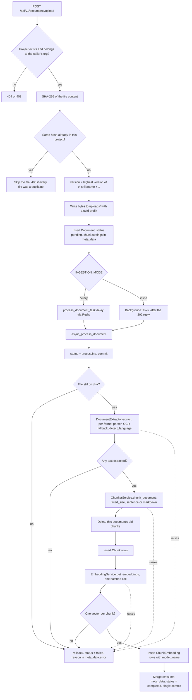

There is no extension allow-list at upload time; a file the extractor cannot read becomes a `failed` document with `Unsupported file type`. Deleting a document's existing chunks before inserting new ones makes re-processing idempotent. A missing document row is skipped quietly, since it may have been deleted after upload.

### Document status

The four values of `Document.status`. The frontend labels them Queued, Processing, Ready and Failed; search only reads `completed` documents.

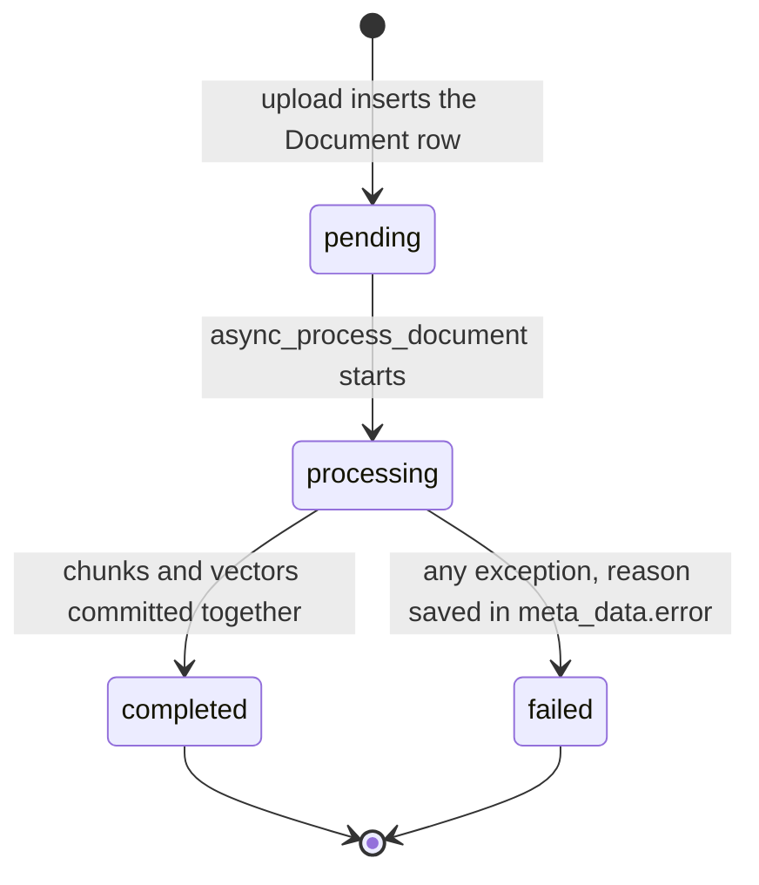

A document that stays `pending` with `INGESTION_MODE=celery` means no worker is consuming the queue.

### Extraction routing

`DocumentExtractor.extract` dispatches by extension. ZIP members re-enter the same dispatcher, and PDFs with almost no text are treated as scans and OCR'd.

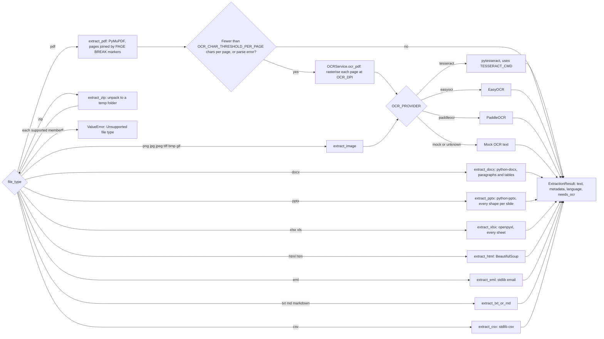

That is 19 extensions in 10 parser families. Pages are joined with a `--- PAGE BREAK ---` marker, which is how a citation can later name a page. The language is detected with `langdetect` and stored in `meta_data`.

### Chunking

Text is split on page markers first, so every chunk records its page, then chunked with the strategy chosen at upload (default `fixed_size`, 500 tokens, 50 overlap). Tokens are counted with `tiktoken` (`cl100k_base`). `chunk_index` is continuous across the document; `page_number` is the page used for citations.

| Strategy | Splits on | Suited to |
|---|---|---|
| `fixed_size` | Sliding token window with overlap | Most documents (default) |
| `sentence` | Whole sentences packed to the token budget | Prose that should not be cut mid-sentence |
| `markdown` | `#` headers, across the whole document rather than per page | Wikis and structured notes |

### Embedding provider selection

`EMBEDDING_PROVIDER` decides how text becomes vectors. Questions must be embedded by the same model as the chunks, so changing provider requires re-processing every document. Gemini fails loudly; the other providers fall back to mock vectors.

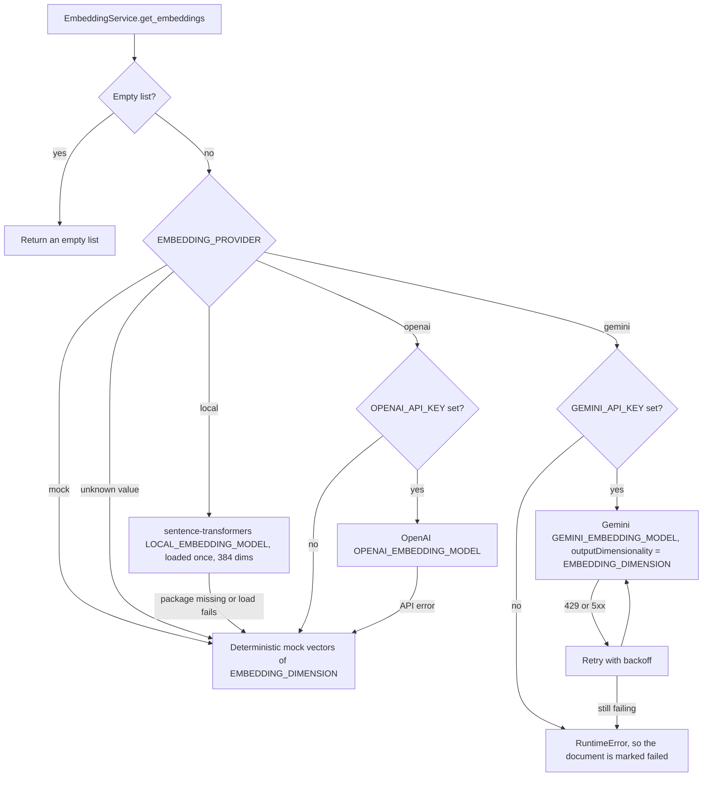

Every vector is stored with `model_name` (for example `all-MiniLM-L6-v2` or `gemini-embedding-001@384`), so rows from an old model can be identified.

### Celery task lifecycle

Only the document id crosses the queue. The diagnostic endpoints in `tasks.py` use the same broker and return `503` when `INGESTION_MODE=inline`.

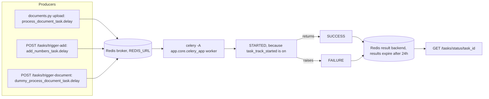

`process_document_task` records its own errors on the document, so its Celery state is normally `SUCCESS` even when the document is `failed`; check `Document.status`. Ingestion has no automatic retry. On Windows the worker needs `--pool=solo` because the prefork pool requires `fork()`.

---

## Answering questions

### Mode dispatch

`POST /api/v1/chat/sessions/{id}/messages` shares authorisation, persistence and response shape between the two modes. The user message is saved before the model is called, so a failed generation still leaves the question in the transcript. Neither mode returns a 500 when the model is missing or fails.

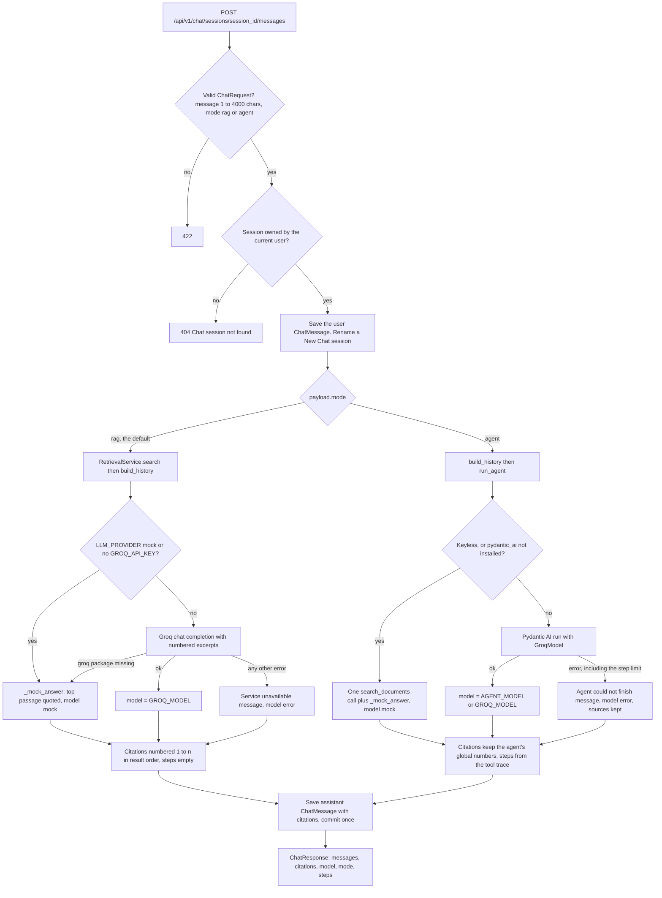

A session titled "New Chat" is renamed from the first 60 characters of its first question.

### Fast RAG pipeline (`mode: "rag"`)

One embedding, one SQL query, one model call. The tenant and project filters are part of the vector query itself.

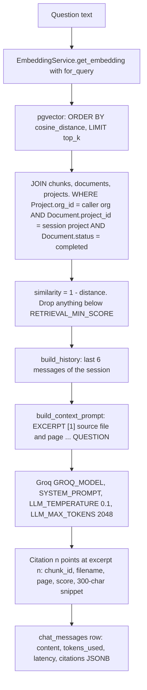

`top_k` defaults to `RETRIEVAL_TOP_K` (5) and a request may raise it to 20. If nothing survives the score threshold the prompt says `EXCERPTS: (none found)` and the system prompt makes the model answer with the not-found sentence. Answers stay grounded through the system prompt (no outside knowledge, no invented citations), the `RETRIEVAL_MIN_SCORE` cut-off, a temperature of 0.1, and citations that map each `[n]` to a real file and page.

---

## Agent mode

### Design

The fixed pipeline performs one search with the whole question. That handles direct questions well but struggles with multi-part questions or comparisons across files, where a single search matches neither half. Agent mode (`services/agent.py`) gives the model tools instead of a fixed set of excerpts. [Pydantic AI](https://ai.pydantic.dev) runs the loop: it builds tool schemas from typed Python functions, validates the model's arguments (an invalid argument becomes a retry, not a crash), executes the tools and enforces a usage limit. The model is Groq via `pydantic-ai-slim[groq]`.

| Tool | Arguments | Behaviour |
|---|---|---|
| `search_documents` | `query`, optional `document_id` | `RetrievalService.search`, optionally narrowed to one document |
| `list_documents` | none | Up to 50 of the project's documents, newest first, with id, type, page count and status |
| `read_document_section` | `document_id`, `start_chunk` (default 0), `count` (default 5, max 10) | Consecutive chunks of one `completed` document, in order |

- **Scoping.** Every tool is bound to the caller's `org_id` and the session's `project_id`, both taken from the authenticated request. The model chooses what to search for, never where. A document id from another tenant gets the same "not found" reply as one that does not exist.
- **Citation numbering.** Each run keeps one registry. The first time any tool surfaces a chunk it receives the next global number, and the model only sees excerpts labelled with those numbers (`EXCERPT [7] ...`), so `[7]` in the answer always means citation 7. A chunk seen twice keeps its first number. The response's citation list contains every surfaced chunk in first-seen order, so it may include excerpts the answer never cites.
- **Scores.** Chunks returned by `read_document_section` carry `score: 0.0`, because they were read rather than ranked.
- **Limits.** `AGENT_MAX_STEPS` (default 6) is passed as `UsageLimits(request_limit=...)`. Reaching it ends the run with an error answer.
- **Concurrency.** Tool calls from one model reply may run concurrently, so every tool takes `deps.lock` around database work; an `AsyncSession` cannot be shared by two coroutines.
- **Self-correction.** Invalid ids and empty results are returned to the model as readable sentences so it can adjust on the next step.
- **Fallbacks.** With no `GROQ_API_KEY`, `LLM_PROVIDER=mock`, or `pydantic-ai` not installed, the agent performs one `search_documents` call itself and returns the same demo answer as rag mode (`model: "mock"`). A failed run (rate limit, network error, invalid key, step limit) returns a readable message with `model: "error"` and keeps the citations already found.
- **Steps.** The tool trace is returned as `steps` (`{tool, args, summary}`) but not stored, so a reloaded conversation shows answers and citations without steps.
- **Testability.** `get_agent()` builds the `Agent` once (`lru_cache`) without a model; the model is supplied per run, which lets `tests/test_agent.py` drive the real agent and tools with a scripted Pydantic AI model and no Groq key.

### Agent loop

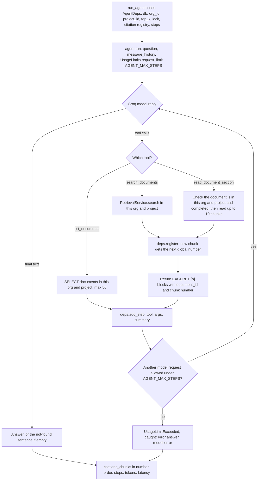

### Agent request sequence

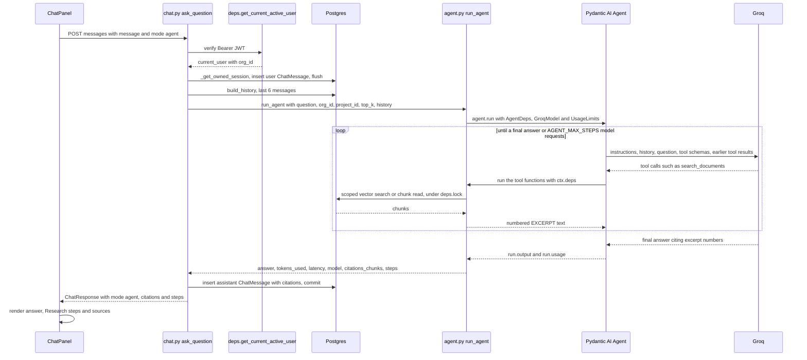

### Comparison

| | `rag` (Quick answer) | `agent` (Deep research) |
|---|---|---|
| LLM calls per question | 1 | Typically 2 to 6, capped by `AGENT_MAX_STEPS` |
| Searches | Exactly one, with the full question | As many as the model chooses, with its own queries |
| Latency and cost | Lowest | Several times higher; Groq rate limits arrive sooner |
| Predictability | Same steps every time | Varies by question; the step trace shows what happened |
| Best for | Direct questions answered in one place | Multi-part questions, cross-document comparisons, summaries, questions naming a file |

---

## Data model

Fifteen tables. Every row traces back to one organisation, which is what makes the `org_id` filter enforceable. Foreign keys cascade on delete, except `audit_logs.user_id` and `invites.invited_by`, which are `SET NULL` so the audit trail and pending invites survive a deleted user.

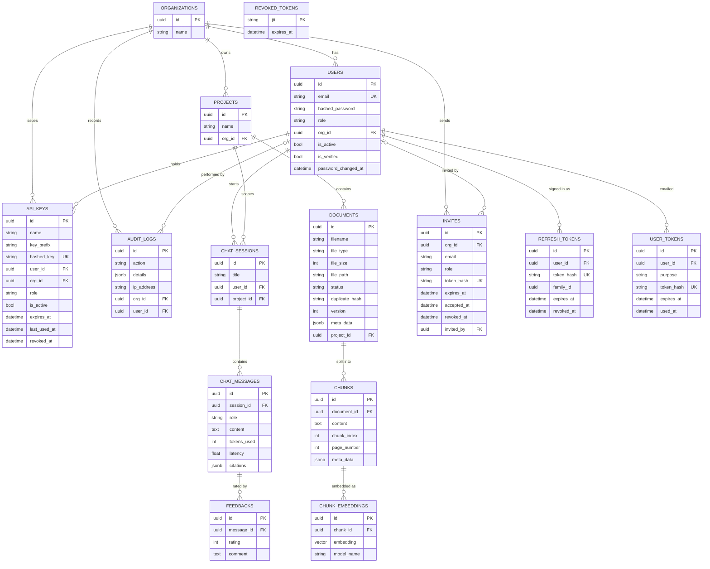

- `chunk_embeddings.embedding` is declared as `Vector(EMBEDDING_DIMENSION)` in the model, but the database column is `vector(384)`, fixed by migration `a1b2c3d4e5f6` (`EMBEDDING_DIM = 384`), with an HNSW `vector_cosine_ops` index. `EMBEDDING_DIMENSION` must match it; inserting a vector of a different length fails. A provider with a different output size (OpenAI `text-embedding-3-small` is 1536) needs a new Alembic migration that alters the column, then re-processing of every document.
- `duplicate_hash` (SHA-256 of the file content) is unique per `(project_id, duplicate_hash)`, not globally. The HNSW index, the `vector` extension and this constraint are defined in migration `a1b2c3d4e5f6_rag_vector_index.py`, not in the model files.
- `documents.meta_data` (JSONB) holds pipeline results: language, word and page counts, chunk count and strategy, embedding model, OCR use, processing time, and `error` when `failed`. The attribute is named `meta_data` because `metadata` is reserved by SQLAlchemy.
- `chat_messages.citations` (JSONB) stores the citations returned with each answer.
- Every token the server issues other than access tokens -- invite, refresh, reset, verification, API key -- is stored only as a SHA-256 hash. `revoked_tokens` holds access-token `jti`s until the token would have expired; logout prunes expired rows.
- `audit_logs` has a composite index on `(org_id, created_at)` for the audit log endpoint.

---

## Authentication and tenant isolation

Login returns a short-lived access token and a rotating refresh token. Every protected endpoint declares `Depends(deps.get_current_active_user)` or a role dependency built on it, so the endpoint body never runs for an invalid credential, and queries are filtered by `current_user.org_id`.

```mermaid
sequenceDiagram
    participant B as Browser lib/api.ts
    participant AUTH as auth.py
    participant API as Any protected endpoint
    participant DEPS as api/deps.py
    participant PG as Postgres
    B->>AUTH: POST /auth/login as an OAuth2 form, username and password
    AUTH->>PG: load user by email, bcrypt verify_password
    AUTH->>PG: store SHA-256 of the refresh token, new family, audit user.login
    AUTH-->>B: access_token for 30 min and refresh_token for 7 days
    B->>API: request with Authorization Bearer token, or X-API-Key
    API->>DEPS: get_current_user
    alt X-API-Key
        DEPS->>PG: look up the key by hash; active, unrevoked, unexpired
        DEPS->>DEPS: effective role is the lower of the key role and the owner role
    else Bearer token
        DEPS->>DEPS: jwt.decode with SECRET_KEY and HS256, require type access
        DEPS->>PG: jti on the revoked_tokens denylist? load User by sub
        DEPS->>DEPS: refuse if iat is before users.password_changed_at
    end
    DEPS->>DEPS: get_current_active_user, 400 if is_active is false
    opt require_role on the endpoint
        DEPS->>DEPS: effective role ranked below the minimum, 403
    end
    API->>PG: query filtered by current_user.org_id
    API-->>B: response
```

| | Access token | Refresh token |
|---|---|---|
| Lifetime | 30 minutes (`ACCESS_TOKEN_EXPIRE_MINUTES`) | 7 days (`REFRESH_TOKEN_EXPIRE_DAYS`) |
| Claims | user id, role, `org_id`, `type=access`, `jti`, `iat` | user id, `type=refresh`, `jti` |
| Server state | Denylisted by `jti` on logout | Row in `refresh_tokens` (hash, family, `revoked_at`) |
| Used for | Every request | `POST /auth/refresh` |

### Signup and invites

- Signup **without** an invite always creates a new organisation and makes the user its Admin. Any `role` in the body is ignored, and `org_id` without an invite is refused with `400`.
- Joining an existing organisation requires an invite token. An Admin creates the invite for one email address and one role (`POST /org/invites`); the token is emailed and returned once, and only its hash is stored. Signup with the token must use the same email; the role comes from the invite and the account is marked verified. Invites expire after `INVITE_EXPIRE_DAYS`, work once, and can be revoked.

### Roles

| Stored role | Alias | May |
|---|---|---|
| `Employee` | viewer | Read projects and documents, search, chat, rate answers |
| `Manager` | editor | Everything a viewer may, plus upload documents and create projects |
| `Admin` | admin | Everything an editor may, plus members, invites, API keys, the audit log and the task diagnostics |

`deps.require_role("editor")` admits that role and every role ranked above it; `require_viewer`, `require_editor` and `require_admin` are the three ready-made dependencies. The stored names are unchanged from earlier releases, so existing rows and tokens keep working. Endpoints for deleting and re-indexing documents should use `require_editor`.

### Sessions

- `/auth/refresh` revokes the presented refresh token and issues a new pair in the same family. Presenting an already-revoked token (a rotated or signed-out one) revokes the whole family, ending the session for both the legitimate user and whoever copied the token. Refresh tokens issued before migration `c3d5e7f9a2b4` have no row and are refused.
- `/auth/logout` denylists the access token's `jti` until its expiry and revokes the refresh token's family. It always returns `204`.
- A password reset sets `password_changed_at` and revokes every refresh token, so all existing sessions end. Deactivating or removing a member also revokes their refresh tokens; `is_active` stops their access tokens immediately.

### Passwords and email

- Policy (`security.password_problems`): at least `PASSWORD_MIN_LENGTH` (10) characters, not all digits, not the email address or its local part. Violations return `422` listing every problem.
- `POST /auth/password-reset/request` returns the same `202` body whether or not the email exists, and sends the email after the response. The single-use link expires after `PASSWORD_RESET_TOKEN_EXPIRE_MINUTES`.
- A self-service signup receives a verification link; `REQUIRE_EMAIL_VERIFICATION=true` makes login wait for it.
- Emails go to the API log unless `SMTP_HOST` is set. A sending failure is logged and never fails the request.

### API keys

Admins create keys with a name, a role (default viewer, never above their own) and an optional expiry. The key (`dm_...`) is returned once; the database keeps a 12-character prefix and the SHA-256 hash. Requests send it as `X-API-Key`. The request acts as the key's owner, scoped to the key's organisation, with the lower of the key's role and the owner's current role. `last_used_at` is updated at most every five minutes.

### Audit log

`services/audit.record` stages a row in the same transaction as the change it describes. Actions written: `user.signup`, `user.login`, `user.login_failed`, `user.logout`, `user.email_verified`, `password.reset_requested`, `password.reset`, `invite.create`, `invite.revoke`, `invite.accept`, `member.role_change`, `member.deactivate`, `member.reactivate`, `member.remove`, `document.upload`, `api_key.create`, `api_key.revoke` (and `document.delete` for a delete endpoint, which should call `audit.record` the same way). `GET /org/audit-logs` pages through them newest first with `limit`, `offset`, `action` (exact, or a prefix ending in `.`), `user_id`, `since` and `until`. The IP is `request.client.host`, so run uvicorn with `--proxy-headers` behind a proxy.

### Other rules

- The `type` claim is checked, so a refresh token cannot be used as an access token.
- An invalid, expired, signed-out or wrong-type credential returns `401`; an inactive account `400`; a role below the endpoint's minimum `403`.
- A row owned by another user or organisation returns `404`, not `403`, so its existence is not revealed. This includes members, invites and API keys on the admin endpoints.
- Path ids are typed `uuid.UUID`, so a malformed id is rejected with `422` before any query runs.
- Response models filter output, so fields such as `hashed_password`, token hashes and API key hashes cannot reach a client.
- With `ENV=production`, the app refuses to start if `SECRET_KEY` is the committed default or shorter than 32 characters, and `/api/v1/tasks/*` returns `404`. Elsewhere those diagnostics require an Admin.
- The frontend (`lib/api.ts`) stores both tokens. On a `401` it calls `/auth/refresh` once, through a single shared in-flight promise so simultaneous `401`s cannot present the same refresh token twice (which the backend would treat as theft), then retries the request; if the refresh fails the user is returned to `/login`. Signing out clears both tokens locally and calls `/auth/logout`. `lib/api.ts` also has typed methods for every new account and admin endpoint, but there are no screens for invites, password reset, email verification, members, API keys or the audit log yet.

---

## API surface

Interactive OpenAPI docs are served at `/docs`. Everything except signup, login, refresh, logout, invite preview, password reset, email verification and the health checks requires `Authorization: Bearer <token>` or `X-API-Key: <key>`.

| Method | Path | Purpose |
|---|---|---|
| `POST` | `/api/v1/auth/signup` | Create a user. Without `invite_token`: a new organisation (optional `org_name`) with the user as Admin. With `invite_token`: join the inviting organisation with the invited role |
| `POST` | `/api/v1/auth/login` | OAuth2 password form (`username`, `password`), returns access and refresh tokens |
| `POST` | `/api/v1/auth/refresh` | Rotate a refresh token for a new pair |
| `POST` | `/api/v1/auth/logout` | Denylist the bearer access token and revoke the refresh token in the body (`refresh_token`); always `204` |
| `GET` | `/api/v1/auth/invites/{token}` | Invite preview: email, role, organisation name, expiry |
| `POST` | `/api/v1/auth/password-reset/request` | Email a reset link (`email`); same `202` whether or not the account exists |
| `POST` | `/api/v1/auth/password-reset/confirm` | Set a new password (`token`, `new_password`); ends all sessions |
| `POST` | `/api/v1/auth/verify-email` | Confirm an email address (`token`) |
| `POST` | `/api/v1/auth/verify-email/resend` | Send a new verification email to the signed-in user |
| `GET` | `/api/v1/users/me` | The current user |
| `GET` / `POST` | `/api/v1/projects/` | List projects / create one (editor or admin) |
| `GET` | `/api/v1/org/members` | Members of the organisation (admin) |
| `PATCH` / `DELETE` | `/api/v1/org/members/{id}` | Change `role` / `is_active`, or remove a member (admin; not yourself, never the last admin) |
| `POST` / `GET` | `/api/v1/org/invites` | Invite an email with a role (token returned once) / list invites with status (admin) |
| `DELETE` | `/api/v1/org/invites/{id}` | Revoke a pending invite (admin) |
| `POST` / `GET` | `/api/v1/org/api-keys` | Create a key (`name`, `role`, `expires_in_days`; key returned once) / list keys (admin) |
| `DELETE` | `/api/v1/org/api-keys/{id}` | Revoke a key (admin) |
| `GET` | `/api/v1/org/audit-logs` | Audit entries, newest first; `limit`, `offset`, `action`, `user_id`, `since`, `until` (admin) |
| `POST` | `/api/v1/documents/upload` | Multipart upload (`project_id`, `files`, optional chunk options), editor or admin; returns `202` with `pending` rows |
| `GET` | `/api/v1/documents/?project_id=` | Documents with status and processing metadata |
| `GET` | `/api/v1/documents/{id}/preview` | The original file |
| `POST` | `/api/v1/search/` | Semantic search only: chunks with scores, no LLM |
| `POST` / `GET` | `/api/v1/chat/sessions` | Start a conversation in a project / list your sessions |
| `GET` | `/api/v1/chat/sessions/{id}/messages` | Transcript |
| `POST` | `/api/v1/chat/sessions/{id}/messages` | Ask a question: `message` (1-4000 chars), optional `top_k` (1-20), optional `mode` (`rag` or `agent`) |
| `DELETE` | `/api/v1/chat/sessions/{id}` | Delete a conversation |
| `POST` | `/api/v1/chat/messages/{id}/feedback` | Rate an answer (`1` or `-1`) |
| `POST` | `/api/v1/tasks/trigger-add`, `/api/v1/tasks/trigger-document` | Queue diagnostics (admin; `503` in inline mode; `404` with `ENV=production`) |
| `GET` | `/api/v1/tasks/status/{task_id}` | Celery task state (admin; `404` with `ENV=production`) |
| `GET` | `/`, `/api/v1/health` | Liveness and configuration report (LLM provider, model, whether a key is configured, embedding settings) |

Search and chat are deliberately separate: search shows exactly what retrieval returned, which distinguishes a retrieval problem from a generation problem.

---

## Frontend

The frontend is a Next.js 16 / React 19 client of the API with no server-side data access. Interactive pages and components are client components (`"use client"`).

- **One API client.** Components never call `fetch` directly. `apiFetch` in `lib/api.ts` attaches the bearer token when present, clears it and redirects to `/login` on `401`, unwraps FastAPI's `detail` (string or validation-error array) into a readable message, and returns `{}` for `204`. `login` (OAuth2 form encoding) and `uploadDocuments` (`FormData`, browser-set multipart boundary) bypass it by necessity.
- **Hand-written types.** The interfaces in `lib/api.ts` mirror `backend/app/schemas/` and must be updated by hand when a schema changes; the end-to-end suite is what detects drift.
- **Token storage.** The access token is stored in `localStorage` behind a `typeof window` guard, since components also render on the server. Client-side route guards are a convenience; the API enforces authorisation.
- **Status polling.** The project page polls the document list every 3 seconds while any document is `pending` or `processing`, stops when all have settled, and clears the interval on cleanup.
- **Optimistic chat.** A question is appended with a temporary id before the response arrives, replaced by the saved message on success, and removed on failure.

### Chat mode flow

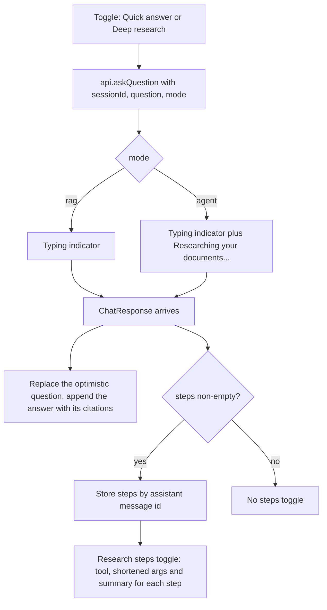

The mode is component state only (default Quick answer) and resets on reload. Steps are stored per assistant message id because the backend does not persist them.

---

## CI pipeline

`.github/workflows/ci.yml` runs on every pull request and on pushes to `main`.

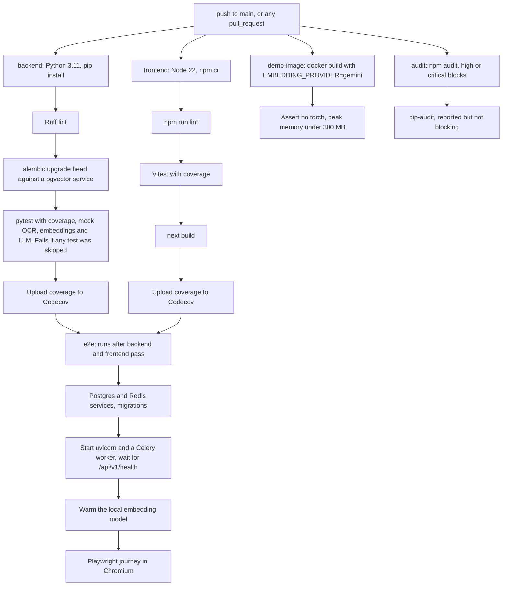

Separate workflows cover CodeQL, Trivy image scanning, OpenSSF Scorecard, Dependabot auto-merge, PR labelling, release drafting, stale issues, AI issue triage and PR review, an uptime check, and a welcome message for new contributors.

---

## Deployment topology

Locally, `backend/docker-compose.yml` provides only Postgres and Redis; the API, worker and frontend run directly. The hosted demo replaces the worker and Redis with inline ingestion and uses managed Postgres and hosted embeddings. See [DEPLOYMENT.md](DEPLOYMENT.md).

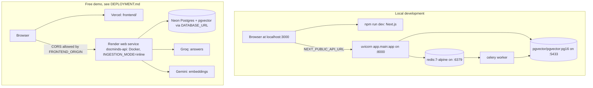

---

## Design decisions

**pgvector instead of a separate vector database.** Vector search is an ordinary SQL query, so it joins up to `projects` and filters on `org_id` inside the query: tenant isolation is part of the query rather than a post-filter. One database also means one backup, one connection pool and one transaction for chunks, vectors and status.

**Text and vectors in separate tables.** `chunks` holds text and `chunk_embeddings` holds vectors with a `model_name`. Re-embedding replaces vectors without touching text, several models can coexist during a migration, and text queries do not load vector data.

**HNSW rather than IVFFlat.** HNSW can be built on an empty table and stays accurate as rows arrive; IVFFlat needs existing data and periodic rebuilds. HNSW costs more memory and build time.

**Keeping the fixed pipeline alongside the agent.** Most questions are direct; one search and one call is faster, cheaper, deterministic and easier to debug. The agent reuses the same retrieval function as a tool, so it is a layer on top rather than a replacement.

**Idempotent ingestion.** Existing chunks are deleted before new ones are inserted, so re-running the task cannot duplicate chunks.

**`NullPool` on the database engine.** Each Celery task calls `asyncio.run()`, creating and closing an event loop. asyncpg connections are bound to the loop that created them, so a pooled connection reused in a later loop fails with `Event loop is closed`.

**Per-project deduplication.** A global unique constraint on `duplicate_hash` would prevent one organisation from uploading a file another already holds, and would reveal that it does. A migration replaced it with a `(project_id, duplicate_hash)` constraint.

**Low temperature and a score threshold.** `LLM_TEMPERATURE=0.1` keeps answers close to the excerpts, and `RETRIEVAL_MIN_SCORE` discards weak matches so the system can answer "not found" instead of answering from unrelated text.
